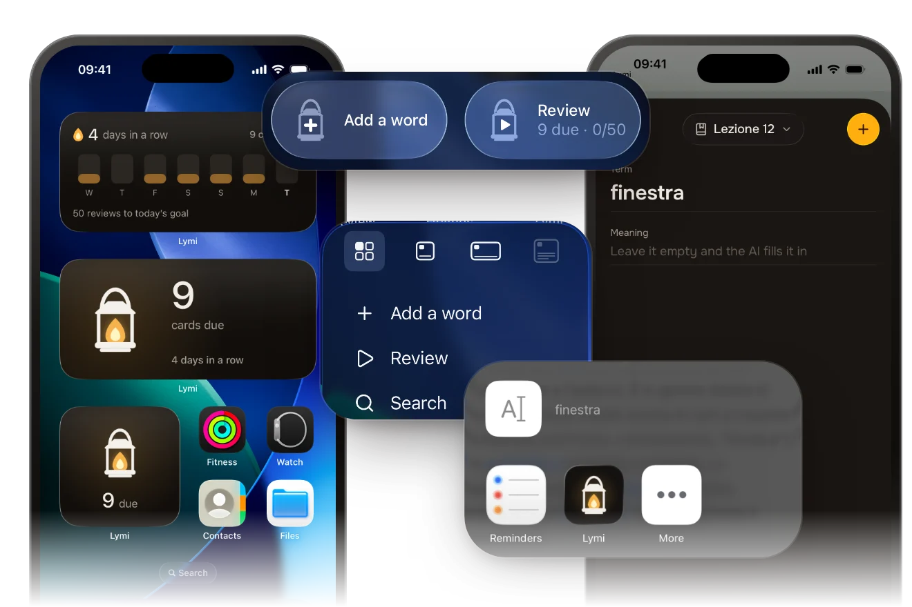
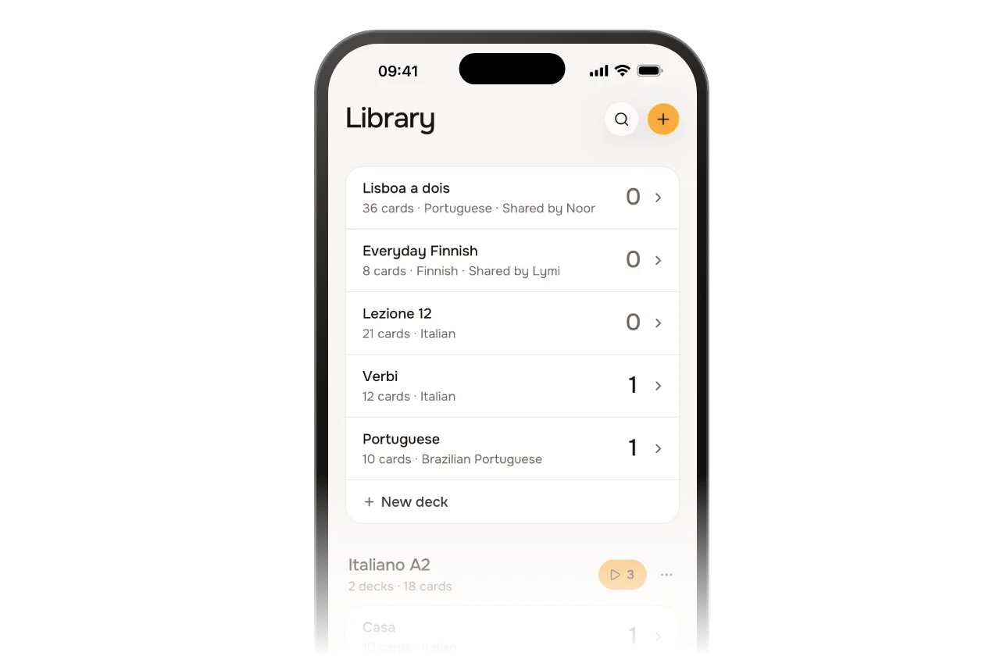

Lymi is now on iPhone. [Get it on the App Store](/download/iphone). Sign in with your Lymi account or with Apple, and your decks and progress are there.

## Review wherever you are

Open Today and choose Review. Recall the answer, reveal it, then grade how well you remembered: Forgot, Hard, Good or Easy. Lymi schedules each card from your grades, as it does on the web.

Without a connection, you can still review the cards already on your phone. Your grades sync when you’re back online.

## Add a card, and Lymi fills in the rest

Type a term, and AI fills the empty fields with a meaning and an example. Each field AI writes is marked, and you can edit it.

Take a photo of your notes, or choose a PDF, and Smart add finds the terms in it.

Japanese cards show furigana over the term. Chinese cards show pinyin, and Russian and Ukrainian cards show stress marks.

## Lymi outside the app

You don’t have to open Lymi to use it.

- Widgets: Lantern shows how many cards are due. Week shows your last seven days and what’s left of today’s goal. There’s also one for the Lock Screen.
- Controls: put Add a word or Review in Control Center, on the Lock Screen or on the Action button. Review shows what’s due.
- The app icon: press and hold it for Add a word, Review and Search.
- Sharing: select a word in Safari or another app and share it to Lymi. It goes into the deck you choose, and AI can fill in the rest.
- Siri and Shortcuts: say “Add a word to Lymi”, or use Add a card in Shortcuts to save a card without opening the app.

## Your decks on your phone

Library has all your decks, and you can group them into series. A shared deck gets new cards as its owner adds them. In Explore, you can add a ready-made deck.

You can also import decks from Anki, Mochi, Quizlet or Noji.

## Keep a daily rhythm

Today shows how many cards are due and how many days in a row you’ve reviewed. At the end of a review, Lymi offers a daily reminder. You can turn it on or off later with Remind me to review in You.

## The same decks everywhere

Your cards and progress are the same on your iPhone, at my.lymi.app and in Lymi for Mac.
