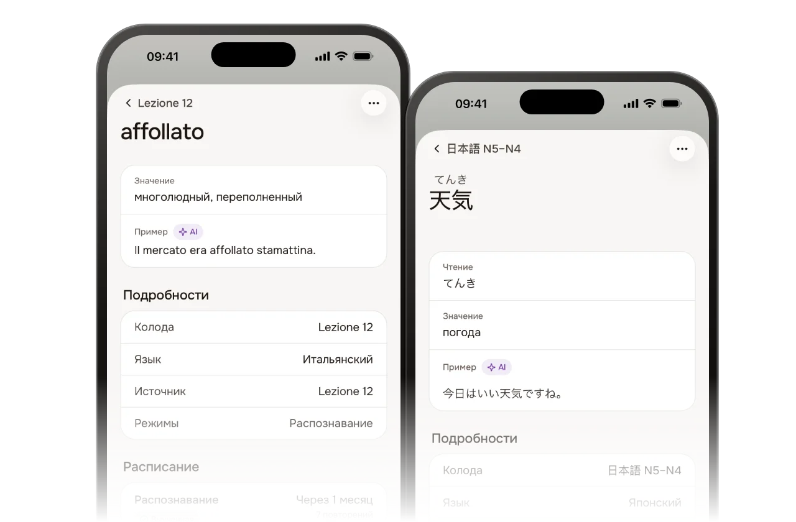
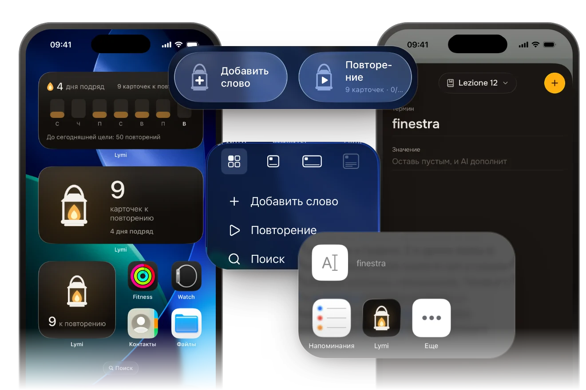
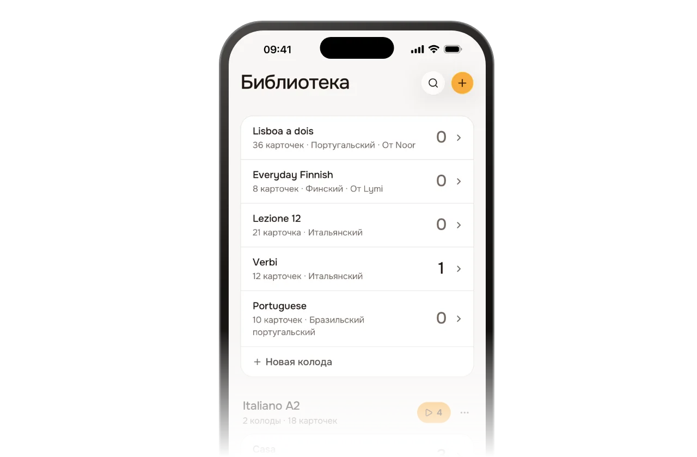

Lymi теперь есть на iPhone. [Скачай в App Store](/download/iphone?locale=ru). Войди через аккаунт Lymi или Apple, и там будут твои колоды и прогресс. В странах ЕС приложения в App Store пока нет.

## Повторяй где угодно

Открой «Сегодня» и нажми «Повторение». Вспомни ответ, открой его и оцени, насколько хорошо помнил: «Не помню», «Трудно», «Хорошо» или «Легко». Lymi планирует каждую карточку по твоим оценкам, так же как в вебе.

Без интернета можно повторять карточки, которые уже есть на телефоне. Оценки синхронизируются, как только появится связь.

## Добавь карточку, а остальное заполнит Lymi

Введи термин, и AI заполнит пустые поля значением и примером. Каждое поле, которое написал AI, отмечено, и его можно изменить.

Сфотографируй заметки или выбери PDF, и «Умное добавление» найдёт в них термины.

Японские карточки показывают фуригану над термином. Китайские показывают пиньинь, а русские и украинские — ударения.

## Lymi вне приложения

Чтобы пользоваться Lymi, его не обязательно открывать.

- Виджеты: «Фонарь» показывает, сколько карточек ждёт повторения. «Неделя» показывает последние семь дней и сколько осталось до сегодняшней цели. Есть и виджет для экрана блокировки.
- Элементы управления: добавь «Добавить слово» или «Повторение» в Пункт управления, на экран блокировки или на кнопку действия. «Повторение» показывает, сколько карточек ждёт.
- Иконка приложения: нажми и удерживай её, чтобы открыть «Добавить слово», «Повторение» или «Поиск».
- Отправка: выдели слово в Safari или другом приложении и поделись им в Lymi. Оно попадёт в выбранную колоду, а остальное может заполнить AI.
- Siri и Команды: скажи «Добавь слово в Lymi» или используй «Добавить карточку» в Командах, чтобы сохранить карточку, не открывая приложение.

## Твои колоды на телефоне

В «Библиотеке» все твои колоды, и их можно объединять в серии. Общая колода получает новые карточки, как только владелец их добавляет. В «Каталоге» можно добавить готовую колоду.

Колоды можно также импортировать из Anki, Mochi, Quizlet или Noji.

## Держи ежедневный ритм

«Сегодня» показывает, сколько карточек ждёт повторения и сколько дней подряд ты повторяешь. В конце повторения Lymi предложит ежедневное напоминание. Позже его можно включить или выключить переключателем «Напоминать о повторении» в разделе «Ты».

## Те же колоды везде

Твои карточки и прогресс одинаковые на iPhone, на my.lymi.app и в Lymi для Mac.
