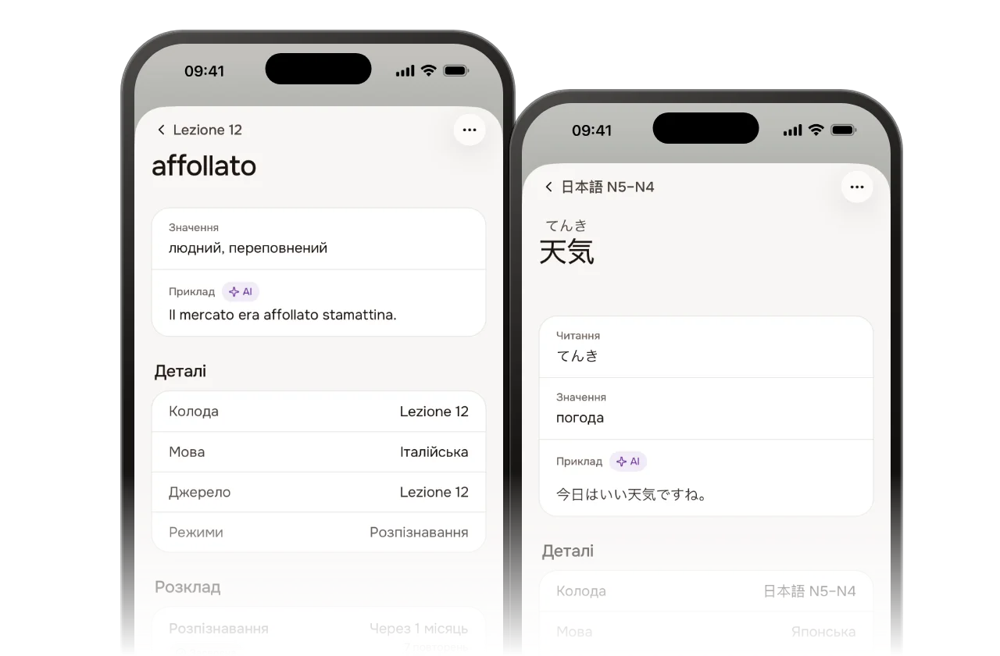
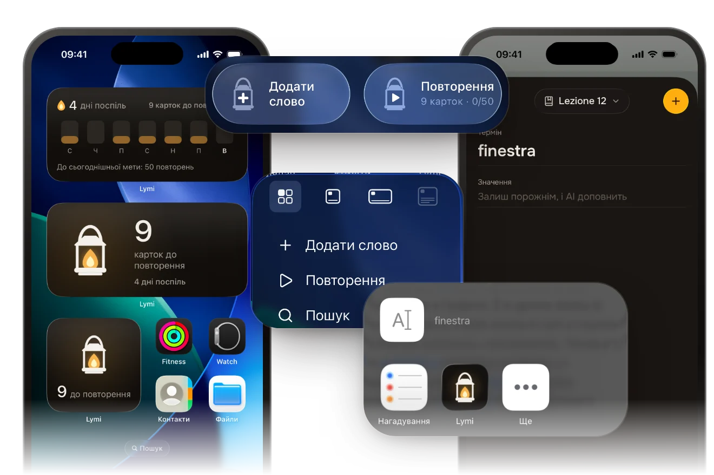
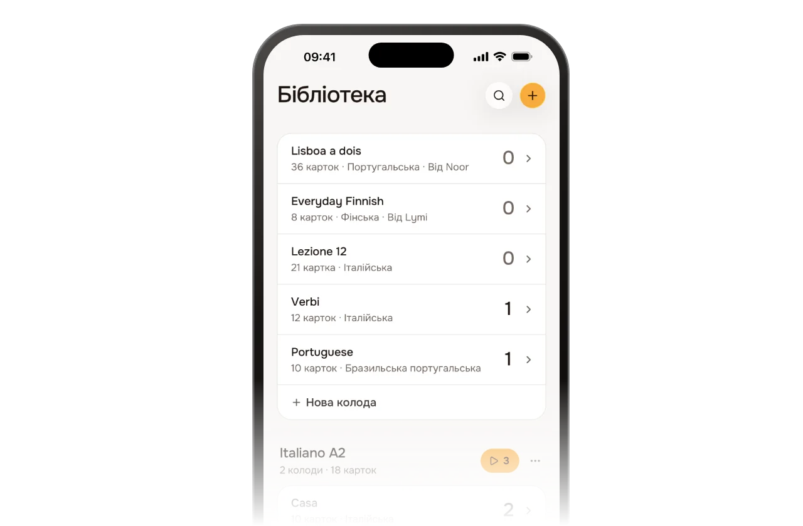

Lymi тепер є на iPhone. [Завантаж в App Store](/download/iphone?locale=uk). Увійди через акаунт Lymi або Apple, і там будуть твої колоди та прогрес. У країнах ЄС застосунку в App Store поки немає.

## Повторюй будь-де

Відкрий «Сьогодні» й натисни «Повторення». Пригадай відповідь, відкрий її й оціни, наскільки добре пам’ятав: «Не пам’ятаю», «Важко», «Добре» чи «Легко». Lymi планує кожну картку за твоїми оцінками, так само як у вебі.

Без інтернету можна повторювати картки, які вже є на телефоні. Оцінки синхронізуються, щойно з’явиться зв’язок.

## Додай картку, а решту заповнить Lymi

Введи термін, і AI заповнить порожні поля значенням і прикладом. Кожне поле, яке написав AI, позначене, і його можна змінити.

Сфотографуй нотатки або вибери PDF, і «Розумне додавання» знайде в них терміни.

Японські картки показують фурігану над терміном. Китайські показують піньїнь, а російські та українські — наголоси.

## Lymi поза застосунком

Щоб скористатися Lymi, його не обов’язково відкривати.

- Віджети: «Ліхтар» показує, скільки карток чекає на повторення. «Тиждень» показує останні сім днів і скільки лишилося до сьогоднішньої мети. Є й віджет для екрана блокування.
- Елементи керування: додай «Додати слово» чи «Повторення» в Пункт керування, на екран блокування або на кнопку дії. «Повторення» показує, скільки карток чекає.
- Іконка застосунку: натисни й утримуй її, щоб відкрити «Додати слово», «Повторення» чи «Пошук».
- Поширення: виділи слово в Safari чи іншому застосунку й поділися ним у Lymi. Воно потрапить у вибрану колоду, а решту може заповнити AI.
- Siri й Команди: скажи «Додай слово в Lymi» або використай «Додати картку» в Командах, щоб зберегти картку, не відкриваючи застосунок.

## Твої колоди на телефоні

У «Бібліотеці» всі твої колоди, і їх можна об’єднувати в серії. Спільна колода отримує нові картки, щойно власник їх додає. У «Каталозі» можна додати готову колоду.

Колоди можна також імпортувати з Anki, Mochi, Quizlet чи Noji.

## Тримай щоденний ритм

«Сьогодні» показує, скільки карток чекає на повторення і скільки днів поспіль ти повторюєш. Наприкінці повторення Lymi запропонує щоденне нагадування. Пізніше його можна ввімкнути чи вимкнути перемикачем «Нагадувати про повторення» в розділі «Ти».

## Ті самі колоди всюди

Твої картки й прогрес однакові на iPhone, на my.lymi.app і в Lymi для Mac.
