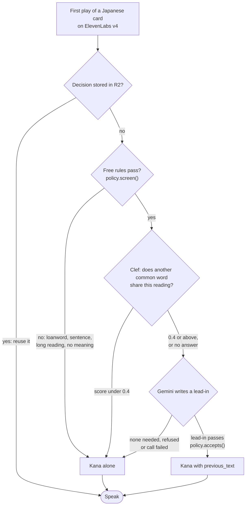

# Lead-ins

A lead-in is the few words a speech engine hears before a term, so it says the sense the learner means. A Japanese card holds はし for a bridge, but はし is also chopsticks and an edge, each with its own pitch. Sent alone, the kana gives the voice nothing to choose with. With 川を渡る sent first, it says the bridge. The lead-in goes to ElevenLabs v4 as `previous_text`, which shapes the delivery but is never spoken, so the clip still holds only the term.

Lead-ins exist only where they help: Japanese is the one language with a policy, and ElevenLabs v4 is the one voice they were auditioned on. Other languages and providers speak the term alone and never reach a model. [The Japanese proposal](proposals/japanese.md) has the listening tests behind this.

## A card is decided once, on its first play

The server decides on the first audio miss for a card's term, reading and meaning, stores the result in R2, and reuses it on every later play and across voices. Most cards stop at the free rules or at the decision model, so the writer is paid only for readings that could name another word.

| Card | Free rules | Clef score | Result |
| --- | --- | --- | --- |
| 橋 はし, bridge | pass | 0.92 | The writer is asked, and a lead-in such as 川を渡る is sent before はし |
| 箸 はし, chopsticks | pass | 0.63 | The writer is asked with chopsticks as the meaning, so this card gets its own lead-in |
| 時計 とけい, clock | pass | 0.23 | Kana alone; no writer call |
| コーヒー, coffee | loanword | not asked | Kana alone; no model call |

The scores come from the evaluation run on 19 October 2026. Other languages, and voices other than ElevenLabs v4, skip the whole flow and speak the term alone.

The free rules live in the policy because they depend on the language. A katakana loanword rarely shares its reading with another word, and a reading over 8 kana is a compound or a phrase that carries its own context. The decision model answers one yes-or-no question per card. The writer is told to return no lead-in for sentences, greetings and time words, and its reply must pass the policy's checks: at most 16 characters, Japanese script only, no repeat of the term or its reading, and no generic word such as とても that fits every sense.

When Clef is down or gives no score, the writer decides alone, as it did before there was a decision model. Missing a homophone is the worse mistake, because the learner hears the wrong word. A unique word flagged by mistake costs one writer call, and the writer can still answer that none is needed.

## What is stored and when it is asked again

| Outcome | Stored as | Asked again |
| --- | --- | --- |
| `unambiguous`, `written`, `no_fragment`, `refused` | A ready record with the lead-in or none, the outcome and Clef's score | When the term, reading, meaning, policy version, decision model, threshold or writer model changes |
| Writer timeout or error status | A failed record; the card plays kana alone | After 24 hours |
| Request cut off mid-decision | The pending marker written before billing | After 5 minutes |
| Another play while one is deciding | Nothing; that play answers 503 "being prepared" | Once the lease ends, at most 45 seconds |
| A stored record that no longer parses or passes the checks | Treated as a miss | On the next play |

A refused reply is kept as no lead-in rather than retried, because at temperature 0 the writer returns the same answer. Bump the policy's `version` after loosening its instructions or checks, and every card of that language is decided again on its next play.

The decision's identity and the lead-in text are part of the ElevenLabs audio key, so a new lead-in makes a new clip. A term, reading or meaning edit clears the card's generated audio. When every speech provider fails, a Japanese card falls back to its kana-only clip from before lead-ins. A recording an import brought never reaches a model. Stored-only preloads read a stored decision and clip but never buy either. A published Japanese deck keeps its stored kana-only clips: the public route and the hourly job voice only cards without audio, so a card gains its lead-in when its owner plays or edits it.

## Cost and time on a first play

On a first play the learner can wait for up to three calls in a row: Clef (about 0.5 seconds, 2.5-second deadline), the writer (4-second deadline) and the speech call. The deadlines leave room for speech inside the phone's 12-second wait. Replays read R2 and call nothing. The writer makes one attempt, with no retry, and at most 768 output tokens, including a 512-token reasoning allowance. Clef runs on the Workers AI allowance. [Gemini pricing](https://ai.google.dev/gemini-api/docs/pricing), checked on 18 October 2026, is $0.10 per million input tokens and $0.40 per million output tokens; the pilot cost about $0.20 per 1,000 writer calls, before speech and storage.

## Measure it

`lead_in_decided` fires once per settled decision, never on a replay, with `language`, `outcome`, `decided_by` (`model`, or `writer` when Clef gave no score) and Clef's `score` rounded to two decimals. Many `no_fragment` outcomes above the threshold mean the threshold flags too much. The writer's cost is `$ai_generation` with `$ai_span_name` `lead_in`. The Worker logs `lead_in_resolved` with the outcome, language and latency, and never the card's text. [Analytics](analytics.md) and [operations](operations.md) hold the contracts and the alerts.

## Change the Japanese policy

The policy is `apps/web/src/server/lead-ins/japanese.ts`. After changing its question, threshold, instructions or checks:

1. Bump `version`.
2. Run `pnpm --filter @lymi/web eval:lead-ins --language ja`. It needs a Wrangler login with Workers AI access, and `--write` also calls the writer, which needs `GEMINI_API_KEY` and the AI Gateway variables in `.dev.vars`.
3. Check that every ambiguous case is still flagged before you accept more flagged clear cases.

On 19 October 2026 the 50 cases in `apps/web/src/server/lead-ins/evaluation.json` scored an AUC of 0.99, with 29 of 29 ambiguous readings flagged and 4 of 21 clear ones flagged at 0.4, in three identical runs. A native speaker has not reviewed those labels yet.

## Add a language

1. Write `apps/web/src/server/lead-ins/<language>.ts` exporting a `LeadInPolicy` from `policy.ts`: the free rules in `screen`, the decision question, the threshold, the writer instructions and the checks in `accepts`.
2. Add it to `POLICIES` in `apps/web/src/server/lead-ins/index.ts`.
3. Add labelled cases under the language's key in `evaluation.json`, with readings that name another word and readings that do not.
4. Run `eval:lead-ins --language <language>` and set the threshold where every ambiguous case is flagged.
5. Have a native speaker listen to the voice with and without lead-ins. If another voice than ElevenLabs v4 should take them, change `takesLeadIn()` in `apps/web/src/server/services/audio.ts`.
6. Add the policy's tests beside it, as `japanese.test.ts` does.
