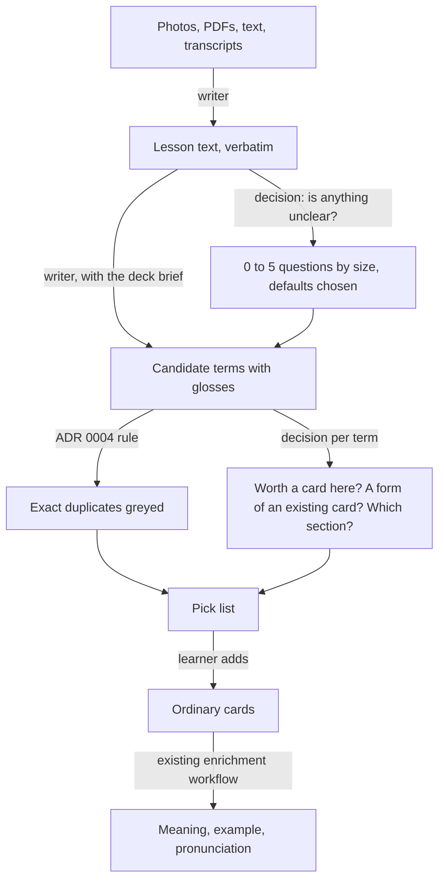

# Add cards from a lesson

A learner opens a deck, pastes a lesson or photographs its pages, and gets back a list of the terms worth a card in that deck. Terms already in their decks are greyed out. They drop what they do not want and add the rest as ordinary cards, which enrichment then fills. This is meant to become a paid feature ([payments](premium-subscription-and-payments.md)), so it starts on the owner's account with every run's cost recorded, and the price follows the numbers.

It should feel like it already knows the learner. It picks the terms they would have picked, writes in the deck's own format, keeps every line short, and asks only what it cannot work out.

This reopens [ADR 0002](../adr/0002-mcp-client-extracts-server-enriches.md), which moved extraction into the MCP client and turned down a prepare endpoint. Extraction through an assistant works, but it is inconsistent: each client reads the deck differently, spends tokens discovering it, and learns about duplicates only after the add.

## Why the app can do it better than an assistant

- **Lymi already holds the deck.** Its terms, sections, languages and the learner's own cards go into the prompt without any tool calls.
- **Duplicates are caught before they are offered**, with the rule of [ADR 0004](../adr/0004-duplicates-are-skipped-not-rejected.md), not skipped after the add.
- **Review data says the learner's level.** Which cards are Known and which keep being forgotten is context no outside assistant has.
- **One prompt and one schema** give every card the same shape, and a fixed set of real lessons keeps its quality from slipping.

## Decisions

- **Material is the input, in any mix.** Photos, PDFs, pasted text or a transcript, and `.txt`, `.md`, `.srt` or `.vtt` files, together in one run. A PDF goes to the model as a file, so scanned pages work too. One lesson is up to 10 pages or photos, or 15,000 words; a bigger upload counts as several, and the count shows before reading. Word files, audio recordings, web links, a topic prompt ("20 words for a restaurant") and "grow this deck" reuse the same pipeline later.
- **It starts from a deck.** "Add from a lesson" sits in the deck's add menu, and the cards land in that deck, and in a section if one is picked.
- **A pick list comes before any card.** Each term shows a one-line gloss and starts ticked; untick to drop, then add. The list is never saved, so there is no draft or proposal entity, and every card that exists is an ordinary card ([ADR 0001](../adr/0001-integration-cards-are-ordinary-cards.md)).
- **Questions are rare.** The learner unticks on the list, so a question earns its place only when one answer unticks several terms at once: none for a page's worth of material, at most one for a few pages, two for a long PDF or transcript. The server drops a question whose answers untick fewer than two terms or every term. Each is a step of its own with radio options and a default already chosen, and every step offers "Use defaults for the rest". Underlined words become "Only the words you marked?"; a PDF holding three lessons becomes "A section for each?"; exercise pages become "Include their words?". The answers change the list.
- **Material is read, not kept.** The phone's file input offers the camera, the library and files. The device shrinks each photo before upload, the Worker checks the bytes as it does for pictures, sends them to the model and discards them. The model writes out the page's text first, and every later step works on that text.
- **App only.** The route accepts a signed-in session, refuses API keys and has no MCP tool, and it stays out of the public API docs. This breaks the rule that REST and MCP expose the same surface, on purpose: an assistant already has a model, and paying Lymi's model to extract for it buys nothing. Assistant extraction improves through tool descriptions and deck context instead.
- **One entitlement check gates it.** It is on for the owner's account only until a paid plan exists. Each run records its input, cached and output tokens per model.

## Two kinds of model

A **writer** reads the page and writes text: the transcript, the terms, the glosses, a question's wording. A **decision model** never writes; it answers a fixed question about some input with a probability per option, in tens of milliseconds, for a fraction of a cent per thousand calls. Every judgement in a run that has a closed set of answers goes to a decision model, so the writer's prompt stays small and each judgement gets a number Lymi can put a threshold on.

Low confidence never decides silently. A term the decision model is unsure about starts unticked rather than hidden, and an unsure section is left for the learner to pick.

## The deck remembers

**The deck brief** is a short note kept on the deck: topic, level, register, how its meanings and examples are written, what the learner skips ("no articles", "Estonian verbs with three principal parts"). It goes into every run in place of most of the raw card list, so runs get cheaper and more consistent as the deck grows.

It learns from what the learner does, never silently:

- After a run, the writer compares the pick list with what was added and edited, and drafts at most one change to the brief.
- The change is shown as one more question with a default, such as "Keep meanings to one or two words?". Accepting writes it into the brief; skipping leaves the brief alone.
- The brief is readable and editable in the deck's settings, so nothing steers the AI that the learner cannot see.

Facts that hold across decks, such as the learner's native language or a level per language, stay out of scope until one deck's brief proves useful. "Deck brief" needs an entry in `CONTEXT.md`.

## Models

The first bake-off ran on 11 October 2026: five photos of the owner's Estonian textbook (two lessons, printed tables with handwritten margins), scored against the 60 words the owner actually made cards from. One run per setup, so the numbers show direction, not a verdict.

**Writers.** One multimodal call per lesson reads every photo and returns the pick list. A separate OCR step costs more than the whole call and loses the layout that shows which words the lesson glossed.

| Writer | Words found | Spelled exactly | Handwritten | Per photo | Per lesson |
|---|---|---|---|---|---|
| Claude Haiku 5.5, low effort | 59/60 | 57 | 3/4 | $0.0009 | 14 s |
| GPT-6 Luna, high effort | 59/60 | 56 | 3/4 | $0.0012 | 30–58 s |
| GPT-6 Luna, low effort | 56/60 | 53 | 0/4 | $0.0006 | 20 s |
| Claude Haiku 5.5, medium effort | 57/60 | 55 | 1/4 | $0.0011 | 15 s |

Haiku 5.5 at low effort reads lessons; Luna stays for enrichment, where its stress marks were the reason to pick it. Gemini is out of the comparison by the owner's choice. What the run taught:

- **The deck brief carries the format.** With eight example cards and no brief, both models skipped every handwritten word and Luna offered 12 phrase cards from request formulas the owner keeps in notes.
- **A brief written by hand can be wrong.** "Verbs end in the 1st person" made both models rewrite the textbook's 3rd-person forms (algab became algan). "Copy every form exactly as printed" fixed it: Lesson 6 came back 31 of 31 exact on both. The brief has to be learned from the deck's cards and confirmed by the learner.
- **Handwriting is the weak spot.** The same setup found three margin words in one run and one in the next; nobody read a note written sideways. Every setup needs three runs before a score counts.
- **The models copy the book's glosses.** The owner rewrote about a third: one meaning instead of three, "(что-то)" and "(само)" to mark verb pairs, a second meaning added. Those edits are the rules the brief should learn, and [the card-writing guide](../card-writing.md) states them for every deck.
- **Duplicates work as designed.** Every model offered küsima and küsimus, already in an earlier section; the ADR 0004 rule greys them before the learner sees the list.

A three-page lesson costs about $0.003 to read, a third of the earlier estimate, so enrichment of the added cards becomes the larger cost.

**Decision models.** All four share one contract, inherited from Jev: send a `state` and named questions of three kinds (yes or no, one of up to 255 choices, or an ordered score) and get probabilities back. None claims its confidence is calibrated, so every threshold comes from labelled Lymi data.

| Model | Per 1M input tokens | Images | In the Worker | Evidence |
|---|---|---|---|---|
| Cloudflare Clef-flash | $0.038 | Up to 4 | `env.AI.run` | Vendor only, English only |
| Cloudflare Clef | $0.24 | Up to 4 | `env.AI.run` | Vendor only, English only |
| TypeSafe Jev | $0.042 | No | `fetch` | Independent: Bonn paper, 91% median on Belebele across 122 languages; overconfident when wrong |
| OpenAI Decisions (Luna) | $0.10 | Base64 | `fetch`, existing key | Vendor only; public beta |

In the bake-off, Clef-flash judged 74 candidates as worth a card or not: 61 words the owner kept, 13 imperatives and phrases they did not. It separated them well (AUC 0.95) but only at a threshold of 0.3: at 0.5 it rejected real words such as aitama. Clef scored 0.86 at six times the price. Picking the lesson section from section names alone was right 61% of the time, so the section comes from the page heading the writer reports, and the decision model only decides keep or skip. 74 Clef-flash calls cost $0.0008.

Leaning: Clef-flash for keep or skip, with a threshold fitted per deck, because it is the cheapest, takes the photo, and adds no vendor or secret. Jev is the comparison, because it is the only one with independent multilingual evidence. Workers AI's free 10,000 neurons a day cover about 2.9 million Clef-flash input tokens.

The same models fit beyond this feature, each behind its own labelled set:

- **Language of a typed term**, over the deck's languages. Script is checked deterministically first, and a low margin between Ukrainian and Russian asks the learner.

## Evals

Write a script in the pattern of the withdrawn diagnosis evaluator (fixtures with expected answers, `--save` and `--from` to rescore without calling again) rather than adopting a tool. The private bake-off in `~/lymi-evals-private/bakeoff` is its first version. OpenAI's Evals API shuts down on 30 November 2026 and AI Gateway Evaluations is closed to new accounts.

`pnpm --filter @lymi/web eval:lesson --models a,b,c` runs the lesson set through each writer and decision model and prints, per model: term precision and recall against a gold list (exact and fuzzy), diacritics, stress on an annotated subset, duplicates offered, section accuracy, cost per run, and p50 and p95 latency. A judge from a different vendor grades glosses pass or fail, checked first against the owner's own labels. `--save` and `--from` rescore without calling again. Scoring code is a Vitest test; model calls are a script.

The lesson set is printed pages, neat and messy handwriting, glare, Cyrillic, Japanese and mixed languages, a page overlapping the deck, and a page with no vocabulary. Generative models "correct" handwriting into text that is not there, so dense accented handwriting matters. Each decision model gets 100 to 200 labelled items per question. Real lessons stay outside the repository, as real cards already do.

In production each run records terms offered, unticked, edited and added by hand right after, with model and prompt version. An unticked or edited term becomes an eval case.

## Delivery

1. **Pick list from a lesson.** The deck menu entry, photos, PDFs and pasted text, questions that grow with the material, Haiku 5.5 choosing terms with the deck's terms and up to ten of the learner's own cards as context, the pick list with duplicates greyed, the add, enrichment on Luna, the entitlement check and cost per run. ADR 0002 is amended in the same pull request, and `docs/stack.md` records the app-only route.
2. **The lesson set and `eval:lesson`**, run before the writer is changed.
3. **Decision models judge.** The "is this unclear?" call, worth-a-card scores with a per-deck threshold, and near-duplicates against the closest existing cards. Clef-flash against Jev on the labelled sets first.
4. **The deck brief**, including the one confirming question after a run.
5. **Edit meanings on the pick list** before adding.
6. **A new deck from a lesson**, with its first brief written from that lesson.

Later, each its own proposal: dictating terms by voice into the same pick list, and reviewing by voice, where a spoken answer is transcribed and graded against the card. Grading an answer is a new review rule, not only a model choice.

## Acceptance evidence

A fixed set of 5–10 of the owner's real lessons, text and photos, run on every change to the prompt or model. On that set, the owner keeps most of each list without adding terms by hand, and no term already in their decks is offered as new. The recorded cost per run across the set becomes the input to the allowance and price.

## Open questions

- The pick list needs a name in `CONTEXT.md`. Suggestion, draft and proposal are already on the avoid list.
- Whether a term matching an archived card should appear, and if so unticked.
- What a free learner sees in the add menu before a paid plan exists: nothing, or the entry with an explanation.
- Which screens are still open from the 28 September prototype: reading, and where the flow starts.
