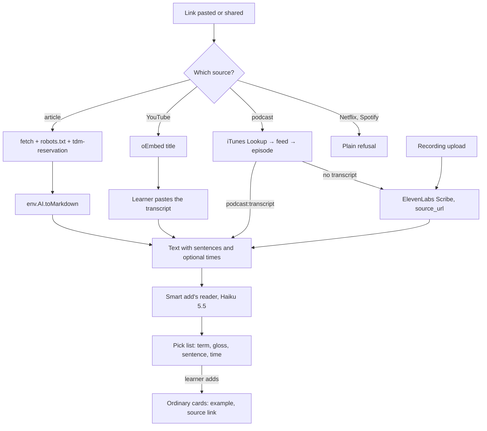

# Cards from links and recordings

A learner reads an article, listens to a podcast or watches a video, and wants the words they met as cards, with the sentence they met each word in. They paste or share the link, or record what they hear, and Smart add returns its usual pick list. Each term on the list carries its sentence from the source, and each card added keeps that sentence as its example and the link as its source.

Kateryna accepted this direction on 17 November 2026 from [the shaping page](https://claude.ai/artifact/E85mf5XJozgMUt6Me5si8b), with one change: **Lymi reads only through routes the source offers officially.** The research and cost notes behind the page cover Migaku, asbplayer, Language Reactor, LingQ, Readlang, Knowt, Quizlet and Noji.

## What each source allows

| Source | What Lymi reads | Route |
| --- | --- | --- |
| Article | The page's text | A plain `fetch`, after robots.txt and the `tdm-reservation` header allow it ([DSM Art. 4](https://www.legislation.gov.uk/eudr/2019/790/article/4)) |
| YouTube | Title and channel only | [oEmbed](https://www.youtube.com/oembed). `captions.download` serves only a learner who can edit the video ([reference](https://developers.google.com/youtube/v3/docs/captions/download)), so captions come from the learner's paste |
| Apple Podcasts or an audio link | The episode's own transcript, or its audio | The iTunes Lookup API gives the feed and episode. A `podcast:transcript` file is used first. Otherwise ElevenLabs Scribe reads the audio from its URL (`source_url`), so Lymi never holds the file |
| Recording | The learner's own audio | Uploaded from the phone or web mic, read by Scribe |
| Netflix, Disney+, Spotify | Nothing | DRM and terms forbid it. Smart add says so plainly |

**Lymi never downloads YouTube or Netflix audio or video.** YouTube's developer policies (III.E.1, III.I.7) and App Store guideline 5.2.3 forbid it, and taking audio or frames from DRM is circumvention ([InfoSoc Art. 6](https://www.legislation.gov.uk/eudr/2001/29/article/6)).

The official-only rule leaves YouTube with two routes. On a computer, the learner opens the video's transcript, copies it with its timestamps and pastes it. On the phone, the learner records the video with the mic. Sharing a YouTube link alone tells the learner which route to take.

## How a link becomes a pick list

- **`LessonMaterial` gains `transcript`**: text split into sentences, each with an optional start time in seconds, plus the source's title and URL. Article text, a pasted YouTube transcript, a podcast transcript and a Scribe result all become this shape, so the reader has one new input.
- **`LessonTermOut` gains `example` and `at`.** `example` is the source sentence holding the term, cut to the 250 characters an example allows ([ADR 0038](../adr/0038-an-example-keeps-its-translation-beside-it.md)). `at` is that sentence's start time, or null. The reader quotes the sentence and never rewrites it.
- **An added card's example has field source `lesson`**, and enrichment writes its translation. The card's `source` is the URL with the time when the source has one: `https://youtu.be/<id>?t=221`. A URL over the 200-character limit drops its query, then its path, as AnkiConnect's `fittedSource` already does.
- **A card shows a source that is a URL as a link**, on web and phone. Today it shows as plain text.
- **A pasted transcript is detected by its shape.** Lines that alternate a time such as `3:41` with text become timed sentences. Any other paste stays a lesson, as today.
- **A read counts against the allowance by size**, as the lesson proposal already says: up to 15,000 words or 15 minutes of audio is one read, and the count shows before reading. A long episode shared with a time reads 15 minutes from that time when its transcript has times. Otherwise the learner is told the episode counts as several reads.
- **Fetching is narrow.** Only `https` URLs on public hosts, a 10-second timeout, 5 MB of HTML, `LymiBot` as the user agent with a link to a page explaining it. A page that refuses gives "This site doesn't allow apps to read it. Paste the text instead."

The route stays `POST /api/lesson-reads`, app only, with a `link` form field beside `text` and `file`. A recording arrives as a `file` of type audio.

## Sharing a link on iOS

The share extension today ignores a URL (`ShareViewController.clean` drops it). It will accept web URLs and show a second sheet: the source's title, then the pick list as it streams, with checkboxes and **Add N cards**. It calls the same route with the app's session, as [ADR 0035](../adr/0035-share-to-lymi-is-a-swiftui-extension-on-the-apps-session.md) set out. The questions step is skipped and takes its defaults.

Opening the app from the extension instead was rejected. Apple does not support it: the known workaround walks the responder chain, and Apple engineers have said it is not allowed ([forum](https://developer.apple.com/forums/thread/80306)). The sheet also keeps the learner in the app they were reading, which is why ADR 0035 chose an extension.

A shared YouTube link shows "YouTube doesn't let apps read its captions. Record it in Lymi, or paste the transcript on a computer." A Netflix or Spotify link shows its own plain sentence.

## Yomitan and asbplayer through AnkiConnect

asbplayer's code (read at commit `d3ff5de9`) sends its sentence clip and screenshot as `addNote`'s `audio` and `picture` parameters. Lymi ignores both today, so the card arrives without them. Its **update last card** sequence calls `findNotes` with `added:1`, then `storeMediaFile`, `notesInfo`, `updateNoteFields` and `addTags`. Lymi has no `added:` query and no `updateNoteFields` or `addTags`, so the update fails.

The fix:

- `addNote` and `addNotes` accept `audio` and `picture` entries with base64 `data`, under the size and format rules `storeMediaFile` already applies.
- The "Lymi card" note type gains **Sentence audio** and **Picture** fields. Sentence audio becomes the example's recording. **Audio** stays the term's recording, which is what Yomitan sends.
- `findNotes` understands `added:N`, and `updateNoteFields` and `addTags` change the learner's own card through the card service.
- Yomitan's app page gets an asbplayer section with the field mapping to choose.

No Lymi model runs, so this costs nothing beyond enrichment.

## Captured clips stay with the owner

A clip or frame that asbplayer or a recording brings is the learner's private copy ([Austro-Mechana, C-433/20](https://ipkitten.blogspot.com/2022/04/cjeu-rules-that-private-copying-also.html)). That cover ends when other people hear it. **A recording or picture marked `captured` plays and shows only for the deck's owner.** Members of a shared deck and a published deck's public page get generated speech and no picture, with the source link. Imports keep today's rule, because a deck file's clips came with the deck.

This narrows `CONTEXT.md`'s **Recording** entry ("A recording goes wherever its deck goes") and needs a `captured` flag beside `example_recording_key`, the term's audio and the picture in `docs/data-model.md`. An export carries captured clips, because it goes to their owner.

## Cost

Prices read on 17 November 2026, converted at the ECB rate of 1.1014. The figures include 24% VAT in case Lymi can't reclaim it.

| Read | Cost |
| --- | --- |
| Article of 2,000 words | €0.004 |
| YouTube with a pasted transcript | €0.004 |
| Podcast with its own transcript | €0.004 |
| 15 minutes of audio through Scribe | €0.06 |
| AnkiConnect card | €0 beyond enrichment |

A €4 plan in Germany leaves €2.88 after VAT and Stripe's fee. Audio is the only line that matters, so a heavy recorder needs the per-read allowance from [payments](premium-subscription-and-payments.md).

## Instrumentation

The product question: are cards from what the learner read or heard reviewed within a week more often than typed cards? `lesson_read` gains `material` (`lesson`, `article`, `transcript`, `podcast` or `recording`), `minutes` for audio, and `refused` (`robots`, `drm`, `youtube`) when Smart add declines a link. `cards_added` from Smart add already carries `source`; a card from a link also lists `example` and `source` in `fields`. AnkiConnect adds `anki_connect_media` with `kind` (`sentence_audio`, `picture`) and `action` (`add`, `update`), never the bytes. Each goes into [analytics](../analytics.md) with the slice that adds it.

## Delivery

1. **AnkiConnect takes asbplayer's media**, with the `captured` flag and owner-only playback. It is independent of every other slice.
2. **Smart add reads an article link**, on web and phone. It adds the `transcript` material, `example` and `at` on the pick list, the source link on cards, and plain refusals for YouTube, Netflix and Spotify links.
3. **A pasted transcript with times** gives each example its time and each card a link to the moment.
4. **The share sheet takes links** and shows the pick list in the extension.
5. **Podcast episodes**, through the iTunes Lookup API, the publisher's transcript, then Scribe.
6. **Smart add takes a recording**, from the mic on phone and web or a shared audio file. First run an Estonian bake-off of Scribe against Workers AI Whisper on three of Kateryna's recordings.
7. **Later, each its own decision:** keeping a sentence's clip from the learner's own recording, cut on the device, and one-line capture at a shared moment.

## Open questions

- Can the YouTube app on iOS copy a transcript? If it can, slice 3 reaches the phone without a recording.
- What does each app's share payload hold on a real device: a title, a time, selected text?
- Should a captured clip play for members of a deck when the owner chooses, or never?
- What is ElevenLabs Scribe's rate on Lymi's plan, and does its Estonian beat Whisper's on real recordings?
