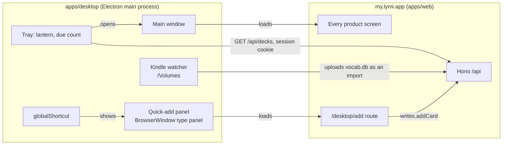

# Mac desktop app

The web app already does the desktop jobs in [PRODUCT.md](../../PRODUCT.md): turning a lesson into cards, tidying a deck, reading Insights. What a browser tab cannot do is be there when Lymi is not open. The Mac app is a thin shell that adds only that: a lantern in the menu bar, a shortcut that adds a card from any app, launch at login, and later the selected text and the Kindle's lookups.

Success looks like this: a term met in a book, a video or a chat lands in a deck in under five seconds without switching to the browser, and the app needs no release when the web changes.

## The shell loads the product, not a copy of it

The window loads `https://my.lymi.app` (the product origin; `lymi.app` is the public site). A web deploy updates the app with no release, and the service worker the product already ships keeps the shell working offline, because Electron runs service workers on an HTTPS origin.

Only `my.lymi.app` loads inside a window: `will-navigate` and `will-redirect` send every other page to the default browser, a path is loaded only when it resolves to the product's origin, and every message from a page is refused unless it comes from the product. Windows run with `contextIsolation` and `sandbox`, and the session grants a page only clipboard writing, notifications and full screen. The preload exposes one bridge, `window.lymiDesktop`, which the web app feature-detects; its type is `DesktopBridge` in `apps/web/src/client/lib/desktop.ts`. An installed app updates long after the web, so the bridge carries a `version`, and a method is only ever added, never renamed or removed; one added after version 1 is optional on the web's side.

## Native parts

**Menu bar.** A `Tray` with the lantern as a template image. Its title, when the learner turns it on, is the cards due now, the sum of `due` over `GET /api/decks`, fetched with the window's session through `session.fetch` every 15 minutes, on wake and after the panel adds. Zero shows no number. The tray menu holds actions only: Add a card, Review, Open Lymi, Settings… and Quit, with Sign in… first while signed out. The count and the tray menu follow a sign-in or sign-out in a window at once, through the session cookie.

**Quick-add panel.** `globalShortcut` (⌃⌥L by default, changeable in This Mac) shows a `BrowserWindow` of `type: "panel"`. On macOS that window floats over full-screen apps and appears on every Space; it takes keyboard focus, as typing needs, without bringing Lymi's other windows forward. A panel that failed to load, such as at login before the network was up, loads again on the next press. It renders a new route in `apps/web`, `/desktop/add`, so the form is the web's own code and ships with every web deploy. The route uses `writes.addCard`, so offline adds queue in the write outbox like every other add, and enrichment fills the empty fields, as every add in the app does. Esc or clicking away hides the panel.

**Launch at login.** `app.setLoginItemSettings({ openAtLogin })` registers the app with `SMAppService` as its main app service. It needs a signed, notarized build to work reliably. `app.setActivationPolicy("accessory")` hides the Dock icon while no main window is open, and `"regular"` brings it back when one opens.

**Selected text.** The shortcut copies the front app's selection and fills the term. macOS gives no API for another app's selection without Accessibility permission, so the app asks for it once; with it, the app presses ⌘C through Core Graphics, reads the clipboard and puts every item back as it was. A paragraph or more than 120 characters is left out. A Mac App Store build cannot do this, which is one reason to ship outside the store. Reading `AXSelectedText` directly would leave the clipboard alone, but it needs native code and fails in many apps, so it can come later as a first try before the copy.

**Kindle lookups (later).** When a volume holding `system/vocabulary/vocab.db` mounts, the shell offers to bring in the new lookups. Readwise imports Kindle highlights but never sees Vocabulary Builder, so this is the only way in. The brief assumed Lymi's importer reads SQLite with `sql.js`; it does not. It walks pages with its own reader in `apps/web/src/server/imports/sqlite.ts`, because `sql.js` copies a database into its heap. So the better shape is a `kindle` import adapter on the server, reading `WORDS` and `LOOKUPS` with that reader, keeping each lookup's sentence as the example and its id as the source id. Then the web's import page takes a `vocab.db` too, Activity lists it, and importing again updates rather than duplicates. The shell only uploads the file. A `My Clippings.txt` adapter for personal documents fits the same slot.

## Sign-in

The window is a browser on `my.lymi.app`, so its Better Auth cookie persists in the app's `persist:lymi` session like any browser's. Email and password work in the window as they are.

Google refuses OAuth inside embedded browsers with `disallowed_useragent`, and Electron's windows count; the system browser also holds the learner's passkeys and Keychain. So the app signs in there, with Better Auth's Electron plugin on the server (`electron()`, its social-sign-in route `/electron/init-oauth-proxy` disabled). The app's scheme `app.lymi.desktop` is deliberately not a trusted origin, so no callback redirect can carry a session cookie to it:

1. The app opens `/desktop/sign-in` in the default browser with a PKCE challenge and a state. Clicking Google or Apple in the app's window does the same, naming the provider; the window stays on the sign-in form.
2. Signed out, that page sends the browser straight to the named provider's page, or through the ordinary login when none is named or the provider cannot start; either returns to it.
3. The learner confirms the account with **Open Lymi for Mac**, so a link alone never signs an app in. The page calls the plugin's `transferUser`, and `ensureElectronRedirect` opens `app.lymi.desktop://auth/callback#token=…`.
4. The app trades the token and its PKCE verifier at `/api/auth/electron/token`, copies the session cookie that call sets into its window session, comes to the front and moves its window on from the sign-in form.

The app does this itself in about fifty lines (`apps/desktop/src/sign-in.ts`) rather than through `@better-auth/electron/client`, which keeps its own cookie store for a local renderer that calls through IPC; Lymi's window is the remote product and needs the cookie in its own session. The phone's `lymi://` scheme stays the phone's.

## Packaging and updates

Electron Forge packages the app (`apps/desktop/forge.config.js`), one build for Apple silicon and one for Intel: `maker-zip` for updates, and a DMG that `dmgbuild` lays out in a Forge hook, because Forge's DMG maker needs native modules pnpm does not build and `dmgbuild` writes the window's layout without driving Finder. Its fuses stop the app running as plain Node, reading `NODE_OPTIONS` or debugger flags, or loading code from outside its signed archive, and they encrypt its cookies. The release job signs with the Developer ID certificate and notarizes with an App Store Connect API key. Electron 45 needs macOS 13 or later.

Builds live in the R2 bucket `lymi-downloads` behind `downloads.lymi.app`. Each chip's folder, `darwin/arm64/` and `darwin/x64/`, holds the update zips, the `RELEASES.json` feed `maker-zip` writes, and `Lymi.dmg`, the newest download. The app reads its own chip's feed with Electron's `autoUpdater` at launch and every hour, downloads in the background, and Squirrel installs the update the next time Lymi quits. Checking stops once an update is downloaded, because on macOS each check downloads it again. Until then the tray menu offers Restart to update. No dialog interrupts an add.

Safari reports every Mac as Intel, so the site cannot pick a file. lymi.app's download button serves Apple silicon, and an Intel link sits below it. One universal build lost: about 230 MB for every download and every update, against about 115 MB.

GitHub Releases with `update.electronjs.org` lost. The repository is public, so it would work, but the repository's Releases page would become the Mac app's, and updates would rest on a free service with no uptime promise. electron-builder lost too: it has an R2 publisher and differential updates, but it is a third-party tool with its own updater, and the shell changes so rarely that a full download per release does not matter.

## Releases

`.github/workflows/desktop.yml` ships every merge that changes `apps/desktop`. It builds both chips, signs and notarizes the apps and the DMGs, launches both signed apps (Intel under Rosetta), checks that Gatekeeper accepts each app and each DMG, and uploads the zip, then the feed, then the DMG. Only `main` releases, and each step sees only the secrets it uses. The version is `1.0.` and the workflow's run number, so each release is newer than the last. Merges that change only the web never release the app. Without the signing secrets the job skips with a notice; the setup is in `apps/desktop/README.md`.

Dependabot proposes Electron once a month, so learners update about once a month. An app that misses updates keeps working, because the bridge only gains methods.

## Keeping it trivial to maintain

The app is a browser around the product, and the product has its own tests, so the app's checks cover only what is unique to it. All of them run on every pull request, in seconds, with nothing to start by hand.

- **The contract between the app and the page** is one set of types in `packages/client/src/desktop.ts`: the bridge, each message and what it carries, and the menu's commands. The page, the preload and the app's handlers are typed by it, so a renamed message, a handler left out or a menu command the page does not answer fails to compile.
- **The app's own rules** live in modules with no Electron in them (`origin.ts`, `settings.ts`, `callback.ts`, `term.ts`) and have unit tests: the origin boundary, the shortcut rule, saved settings, the sign-in link and cookie copy, telling a sign-in from a session refresh, and the selected text.
- **The pages only the app shows**, the quick-add panel and This Mac, have component tests against a stand-in for the app, and the server's side of the sign-in hand-off has its own.
- **Electron stays current by itself:** Dependabot opens one pull request a month for `electron` alone, and Electron's own types change with it, so TypeScript and the tests say whether an upgrade touched anything the app uses. A green one merges.
- **The packaged app launches:** a pull request that changes `apps/desktop` packages it and starts it on a Mac runner (`scripts/launch-check.js`), and the release does the same with the signed build. It must open a product page with the bridge in place, which catches an Electron upgrade, a fuse or a signature that breaks the app.

No end-to-end suite: it would mostly test the browser again. A short check by hand is worth it only when a pull request changes the shortcut, the panel, the selected text or launch at login, which macOS's own interface decides and a runner cannot drive.

## Not in the first version

- **Windows.** Electron makes the code cheap, but the signing is not: Microsoft's Artifact Signing takes individuals only in the US and Canada, so from the EU it needs a registered company, and a bought certificate costs €200–350 a year. Even signed, a new app shows Windows' warning until enough people install it. It also needs its own title bar, tray and panel (no `panel` type) and a PC to test on. Nobody has asked; revisit when learners do, or once Lymi is a company. The platform checks stay in one file.
- **The Mac App Store.** Its sandbox forbids the selected-text copy and reading `/Volumes` without asking for each file.
- **Native screens.** Every screen stays the web's.

## Instrumentation

`signed_in` carries `client=mac` with `via` (`browser` for the hand-off's token trade, `window` for the app's own window), so a funnel from `mac_download_started` shows how many Mac installs end up signed in and which way. The question: does adding from anywhere get used, and does it raise how many cards a week come from outside a lesson? The panel adds with `from=desktop_panel`, which rides in the queued write so an offline add keeps it, and `cards_added` then carries `entry: "desktop_panel"` beside its `typed` source. No event for opening the panel or the tray; adds are the outcome. The hidden panel sends no page view and never settles the day, so it cannot count a day as opened.

## Decided on 23 October

- **The panel is one line**: the term in a 480 px Lymi plate, its deck as quiet text at the end, and nothing else until something is added. The window around the plate is clear and macOS shadows it. Tried and dropped: the macOS frosted material with the native pop-up menu (it looked apart from Lymi), the add bar with an "Add … to …" row and key hints (busy), a note line under the term, and deck chips.
- **The deck follows the term's language** through `POST /api/cards/deck-choice`, then the last deck added to, until the learner picks one. ↓ in the term or Enter on the deck opens the list; ↑↓ and Enter pick; Esc closes the list and then the panel. Tab moves between the term and the deck as usual.
- **After an add the panel stays open**, the field cleared, with a line saying what was added and Undo (⌘Z). Esc or a click away hides it.
- **The menu bar shows the lantern, without the count**, as the lantern mark itself (solid metal, an open glass, the flame with its core cut out) that macOS tints. A line drawing and the flame alone were tried and set aside. This Mac turns the count on, and can hide the lantern altogether; Lymi then keeps its Dock icon, so it can always be reached.
- **Mac settings live in Settings, under This Mac**, shown only inside the Mac app: the quick-add shortcut (recorded by pressing it, refused when another app holds it), whether the lantern shows in the menu bar, the due count beside it, filling in selected text with the Accessibility state and a way to System Settings, and open at login. They are kept on the Mac in `preferences.json`, not on the account, so each Mac keeps its own. ⌘, and the tray's Settings… open them; the tray menu keeps only actions.
- **The app menu is the Mac's standard one** with Lymi's commands: File (New Card, New Deck, Smart Add, Import), Edit (the standard items, which make ⌘C and ⌘V work in fields, and Find for the command menu), View (Command Menu, light and dark, zoom), Go (Today to Activity, Back and Forward), Review (Start Review and the three rounds), Window (Quick Add) and Help. Each item sends a command to the page, which runs it as the command menu would. It shows only while a window is open. English only for now.
- **The main window draws its own 40 px title bar on every screen**, holding only the traffic lights, centred in it 20 px in, so they never move between screens. Every screen starts below it: the rail's Lymi row, with the streak and the add button, and the screen's title sit level just under it. The whole bar moves the window. Full screen hides the lights, so the bar goes too. Tried and replaced: the lights on the rail's row 40 px down with an 18 px strip, which floated over Review, the sign-in form and the narrow window; and a 52 px bar holding the rail's row beside the lights, which squeezed the streak and the add button.
- **Signed out, the main window is the sign-in window**: 440 by 720, fixed, with the form drawn on the window rather than as a plate inside it. Signing in, in it or through the browser, grows it to the app's size and moves it on to Today, or to where the learner was headed; signing out shrinks it again. The tray's Sign in… and a signed-out add open it rather than the browser.
- **The download explains itself.** The DMG opens on the light room with the lantern lit: Lymi's icon sits in a pool of its own light, an amber arrow carries that light to a dashed place around the Applications folder, and the one heading says to drag Lymi into Applications. Lymi opened from anywhere else offers to move itself to Applications at each launch, since only there does it update itself and receive the browser's hand-back.
- **The shortcut is ⌃⌥L.** ⌥⌘L is Finder's Downloads.
- Mac only, outside the Mac App Store.
