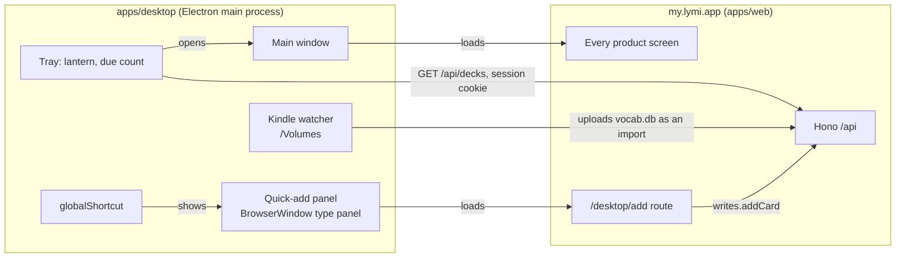

# Mac desktop app

The web app already does the desktop jobs in [PRODUCT.md](../../PRODUCT.md): turning a lesson into cards, tidying a deck, reading Insights. What a browser tab cannot do is be there when Lymi is not open. The Mac app is a thin shell that adds only that: a lantern in the menu bar, a shortcut that adds a card from any app, launch at login, and later the selected text and the Kindle's lookups.

Success looks like this: a term met in a book, a video or a chat lands in a deck in under five seconds without switching to the browser, and the app needs no release when the web changes.

## The shell loads the product, not a copy of it

The window loads `https://my.lymi.app` (the product origin; `lymi.app` is the public site). A web deploy updates the app with no release, and the service worker the product already ships keeps the shell working offline, because Electron runs service workers on an HTTPS origin.

Only `my.lymi.app` loads inside a window. Every other link opens in the default browser through `setWindowOpenHandler` and `will-navigate`. Windows run with `contextIsolation` and `sandbox`, and the preload exposes one small bridge, `window.lymiDesktop`, which the web app feature-detects: `hidePanel()` and `selectedText()` for now.

## Native parts

**Menu bar.** A `Tray` with the lantern as a template image. Its title is the cards due now, the sum of `due` over `GET /api/decks`, fetched with the window's session through `session.fetch` every 15 minutes, on wake and after the panel adds. Zero shows no number. The tray menu has Review, Add a card, Open Lymi, Show due count, Open at login, and Quit.

**Quick-add panel.** `globalShortcut` (⌃⌥L by default, changeable in the tray menu) shows a `BrowserWindow` of `type: "panel"`. On macOS that window floats over full-screen apps and appears on every Space without taking focus from the app beneath. It renders a new route in `apps/web`, `/desktop/add`, so the form is the web's own code and ships with every web deploy. The route uses `writes.addCard`, so offline adds queue in the write outbox like every other add, and enrichment fills the empty fields, as every add in the app does. Esc or clicking away hides the panel.

**Launch at login.** `app.setLoginItemSettings({ openAtLogin })` registers the app with `SMAppService` as its main app service. It needs a signed, notarized build to work reliably. `app.setActivationPolicy("accessory")` hides the Dock icon while no main window is open, and `"regular"` brings it back when one opens.

**Selected text (later).** The shortcut copies the frontmost app's selection and fills the term. macOS gives no API for another app's selection without Accessibility permission, so the shell asks for it once, sends ⌘C, reads the clipboard and puts the old clipboard back. A Mac App Store build cannot do this, which is one reason to ship outside the store.

**Kindle lookups (later).** When a volume holding `system/vocabulary/vocab.db` mounts, the shell offers to bring in the new lookups. Readwise imports Kindle highlights but never sees Vocabulary Builder, so this is the only way in. The brief assumed Lymi's importer reads SQLite with `sql.js`; it does not. It walks pages with its own reader in `apps/web/src/server/imports/sqlite.ts`, because `sql.js` copies a database into its heap. So the better shape is a `kindle` import adapter on the server, reading `WORDS` and `LOOKUPS` with that reader, keeping each lookup's sentence as the example and its id as the source id. Then the web's import page takes a `vocab.db` too, Activity lists it, and importing again updates rather than duplicates. The shell only uploads the file. A `My Clippings.txt` adapter for personal documents fits the same slot.

## Sign-in

The window is a browser on `my.lymi.app`, so its Better Auth cookie persists in the app's `persist:lymi` session like any browser's. Email and password work in the window as they are.

Google refuses OAuth inside embedded browsers with `disallowed_useragent`, and Electron's windows count. Apple's web flow loads, but the system browser has the learner's passkeys and Keychain. So both go through the system browser with Better Auth's own Electron integration (`@better-auth/electron`): the server plugin `electron()`, a custom scheme such as `app.lymi.desktop:/` in `trustedOrigins`, PKCE, and a code the shell exchanges for the session. The shell then sets that session as the `my.lymi.app` cookie in its window session. The phone's `lymi://` scheme stays the phone's. A pasted code is the integration's own fallback when the scheme fails.

Risk to test first: the integration expects a local renderer calling through IPC, while Lymi's window is the remote web app. Setting the returned session as a cookie is the step the docs do not cover.

## Packaging and updates

Electron Forge, the Electron team's own tool: `maker-dmg` for the download, `maker-zip` for updates, `osxSign` and `osxNotarize` with an App Store Connect API key, run by a manual GitHub Actions workflow on a macOS runner, like Phone beta.

The repository is private, so `update.electronjs.org`, which reads public GitHub releases, is out. Instead `@electron-forge/publisher-s3` pushes each build to an R2 bucket behind `downloads.lymi.app`, and `update-electron-app` points Squirrel.Mac at that static feed. R2's S3 endpoint always needs credentials, so the public custom domain is the read path. The cost is a few megabytes of storage per release.

electron-builder lost: it has an R2 publisher and differential updates, but it is a third-party tool with its own updater, and the shell changes so rarely that a full download per release does not matter.

## Keeping Electron cheap

Electron ships a major every eight weeks and supports the latest three, so a shell left alone falls out of support in about six months.

- Dependabot, configured for `apps/desktop` only, opens one grouped weekly pull request for `electron` and `@electron-forge/*`.
- CI on a macOS runner packages the app and runs a Playwright `_electron` smoke test: the app launches against a local page, the tray exists, the shortcut's handler shows the panel, and the panel loads its route.
- A green bump merges and the next release ships it. The shell holds almost no code, so a major rarely breaks it.

## Not in the first version

- **Windows.** Electron makes it cheap later, but a Windows build needs its own signing, its own panel behaviour (no `panel` type) and its own test. Nobody has asked; ship the Mac and write the code so the platform checks are in one file.
- **The Mac App Store.** Its sandbox forbids the selected-text copy and reading `/Volumes` without asking for each file.
- **Native screens.** Every screen stays the web's.

## Instrumentation

The question: does adding from anywhere get used, and does it raise how many cards a week come from outside a lesson? `cards_added` gains `entry: "desktop_panel"` from the panel's requests through `x-lymi-client`, as the phone's App Intents add `entry: "shortcut"`. No event for opening the panel or the tray; adds are the outcome.

## Decided on 23 October

- **The panel is the add bar** (option A on [the visual page](https://claude.ai/artifact/GQeq92LoDbKaDf5uw8awaa)): one line like the command menu's add strip, with the deck as a native pop-up menu. It sits on the window's own macOS material (`vibrancy: "popover"`), not a plate Lymi draws, and keeps Onest. Liquid Glass would need `electron-liquid-glass`, which calls a private AppKit API, so it waits for Electron to support it.
- **After an add the panel stays open**, the field cleared, with a line saying what was added and Undo (⌘Z). Esc or a click away hides it.
- **The menu bar shows the due count** by default; the tray menu turns it off.
- **The shortcut is ⌃⌥L.** ⌥⌘L is Finder's Downloads.
- Mac only, outside the Mac App Store.
