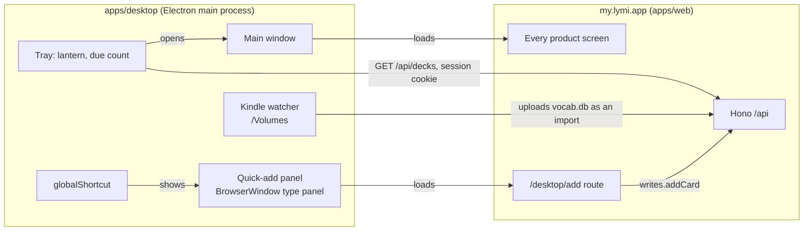

# Mac desktop app

The web app already does the desktop jobs in [PRODUCT.md](../../PRODUCT.md): turning a lesson into cards, tidying a deck, reading Insights. What a browser tab cannot do is be there when Lymi is not open. The Mac app is a thin shell that adds only that: a lantern in the menu bar, a shortcut that adds a card from any app, launch at login, and later the selected text and the Kindle's lookups.

Success looks like this: a term met in a book, a video or a chat lands in a deck in under five seconds without switching to the browser, and the app needs no release when the web changes.

## The shell loads the product, not a copy of it

The window loads `https://my.lymi.app` (the product origin; `lymi.app` is the public site). A web deploy updates the app with no release, and the service worker the product already ships keeps the shell working offline, because Electron runs service workers on an HTTPS origin.

Only `my.lymi.app` loads inside a window: `will-navigate` and `will-redirect` send every other page to the default browser, a path is loaded only when it resolves to the product's origin, and every message from a page is refused unless it comes from the product. Windows run with `contextIsolation` and `sandbox`, and the session grants a page only clipboard writing, notifications and full screen. The preload exposes one bridge, `window.lymiDesktop`, which the web app feature-detects; its type is `DesktopBridge` in `apps/web/src/client/lib/desktop.ts`. An installed app updates long after the web, so the bridge carries a `version`, and a method is only ever added, never renamed or removed; one added after version 1 is optional on the web's side.

## Native parts

**Menu bar.** A `Tray` with the lantern as a template image. Its title, when the learner turns it on, is the cards due now, the sum of `due` over `GET /api/decks`, fetched with the window's session through `session.fetch` every 15 minutes, on wake and after the panel adds. Zero shows no number. The tray menu holds actions only: Add a card, Review, Open Lymi, Settings… and Quit, with Sign in… first while signed out. The count and the tray menu follow a sign-in or sign-out in a window at once, through the session cookie.

**Quick-add panel.** `globalShortcut` (⌃⌥L by default, changeable in This Mac) shows a `BrowserWindow` of `type: "panel"`. On macOS that window floats over full-screen apps and appears on every Space; it takes keyboard focus, as typing needs, without bringing Lymi's other windows forward. A panel that failed to load, such as at login before the network was up, loads again on the next press. It renders a new route in `apps/web`, `/desktop/add`, so the form is the web's own code and ships with every web deploy. The route uses `writes.addCard`, so offline adds queue in the write outbox like every other add, and enrichment fills the empty fields, as every add in the app does. Esc or clicking away hides the panel.

**Launch at login.** `app.setLoginItemSettings({ openAtLogin })` registers the app with `SMAppService` as its main app service. It needs a signed, notarized build to work reliably. `app.setActivationPolicy("accessory")` hides the Dock icon while no main window is open, and `"regular"` brings it back when one opens.

**Selected text.** The shortcut copies the front app's selection and fills the term. macOS gives no API for another app's selection without Accessibility permission, so the app asks for it once; with it, the app presses ⌘C through Core Graphics, reads the clipboard and puts every item back as it was. A paragraph or more than 120 characters is left out. A Mac App Store build cannot do this, which is one reason to ship outside the store. Reading `AXSelectedText` directly would leave the clipboard alone, but it needs native code and fails in many apps, so it can come later as a first try before the copy.

**Kindle lookups (later).** When a volume holding `system/vocabulary/vocab.db` mounts, the shell offers to bring in the new lookups. Readwise imports Kindle highlights but never sees Vocabulary Builder, so this is the only way in. The brief assumed Lymi's importer reads SQLite with `sql.js`; it does not. It walks pages with its own reader in `apps/web/src/server/imports/sqlite.ts`, because `sql.js` copies a database into its heap. So the better shape is a `kindle` import adapter on the server, reading `WORDS` and `LOOKUPS` with that reader, keeping each lookup's sentence as the example and its id as the source id. Then the web's import page takes a `vocab.db` too, Activity lists it, and importing again updates rather than duplicates. The shell only uploads the file. A `My Clippings.txt` adapter for personal documents fits the same slot.

## Sign-in

The window is a browser on `my.lymi.app`, so its Better Auth cookie persists in the app's `persist:lymi` session like any browser's. Email and password work in the window as they are.

Google refuses OAuth inside embedded browsers with `disallowed_useragent`, and Electron's windows count; the system browser also holds the learner's passkeys and Keychain. So the app signs in there, with Better Auth's Electron plugin on the server (`electron()`, its social-sign-in route `/electron/init-oauth-proxy` disabled). The app's scheme `app.lymi.desktop` is deliberately not a trusted origin, so no callback redirect can carry a session cookie to it:

1. The app opens `/desktop/sign-in` in the default browser with a PKCE challenge and a state. Clicking Google or Apple in the app's window does the same.
2. Signed out, that page sends the browser through the ordinary login, which returns to it.
3. The learner confirms the account with **Open Lymi for Mac**, so a link alone never signs an app in. The page calls the plugin's `transferUser`, and `ensureElectronRedirect` opens `app.lymi.desktop://auth/callback#token=…`.
4. The app trades the token and its PKCE verifier at `/api/auth/electron/token` and copies the session cookie that call sets into its window session.

The app does this itself in about fifty lines (`apps/desktop/src/sign-in.ts`) rather than through `@better-auth/electron/client`, which keeps its own cookie store for a local renderer that calls through IPC; Lymi's window is the remote product and needs the cookie in its own session. The phone's `lymi://` scheme stays the phone's.

## Packaging and updates

Electron Forge, the Electron team's own tool: `maker-dmg` for the download, `maker-zip` for updates, `osxSign` and `osxNotarize` with an App Store Connect API key, run by a manual GitHub Actions workflow on a macOS runner, like Phone beta.

The repository is private, so `update.electronjs.org`, which reads public GitHub releases, is out. Instead `@electron-forge/publisher-s3` pushes each build to an R2 bucket behind `downloads.lymi.app`, and `update-electron-app` points Squirrel.Mac at that static feed. R2's S3 endpoint always needs credentials, so the public custom domain is the read path. The cost is a few megabytes of storage per release.

electron-builder lost: it has an R2 publisher and differential updates, but it is a third-party tool with its own updater, and the shell changes so rarely that a full download per release does not matter.

## Keeping Electron cheap

Electron ships a major every eight weeks and supports the latest three, so a shell left alone falls out of support in about six months.

- Dependabot, configured for `apps/desktop` only, opens one grouped weekly pull request for `electron` and `@electron-forge/*`.
- CI on a macOS runner packages the app and runs a Playwright `_electron` smoke test: the app launches against a local page, the tray exists, the shortcut's handler shows the panel, and the panel loads its route.
- A green bump merges and the next release ships it. The shell holds almost no code, so a major rarely breaks it.

## Not in the first version

- **Windows.** Electron makes it cheap later, but a Windows build needs its own signing, its own panel behaviour (no `panel` type) and its own test. Nobody has asked; ship the Mac and write the code so the platform checks are in one file.
- **The Mac App Store.** Its sandbox forbids the selected-text copy and reading `/Volumes` without asking for each file.
- **Native screens.** Every screen stays the web's.

## Instrumentation

The question: does adding from anywhere get used, and does it raise how many cards a week come from outside a lesson? The panel adds with `from=desktop_panel`, which rides in the queued write so an offline add keeps it, and `cards_added` then carries `entry: "desktop_panel"` beside its `typed` source. No event for opening the panel or the tray; adds are the outcome. The hidden panel sends no page view and never settles the day, so it cannot count a day as opened.

## Decided on 23 October

- **The panel is one line**: the term in a 480 px Lymi plate, its deck as quiet text at the end, and nothing else until something is added. The window around the plate is clear and macOS shadows it. Tried and dropped: the macOS frosted material with the native pop-up menu (it looked apart from Lymi), the add bar with an "Add … to …" row and key hints (busy), a note line under the term, and deck chips.
- **The deck follows the term's language** through `POST /api/cards/deck-choice`, then the last deck added to, until the learner picks one. ↓ in the term or Enter on the deck opens the list; ↑↓ and Enter pick; Esc closes the list and then the panel. Tab moves between the term and the deck as usual.
- **After an add the panel stays open**, the field cleared, with a line saying what was added and Undo (⌘Z). Esc or a click away hides it.
- **The menu bar shows the lantern, without the count**, as a line drawing of the lantern (bail, flared hood, glass and foot in one weight, a small flame) that macOS tints. This Mac turns the count on, and can hide the lantern altogether; Lymi then keeps its Dock icon, so it can always be reached.
- **Mac settings live in Settings, under This Mac**, shown only inside the Mac app: the quick-add shortcut (recorded by pressing it, refused when another app holds it), whether the lantern shows in the menu bar, the due count beside it, filling in selected text with the Accessibility state and a way to System Settings, and open at login. They are kept on the Mac in `preferences.json`, not on the account, so each Mac keeps its own. ⌘, and the tray's Settings… open them; the tray menu keeps only actions.
- **The app menu is the Mac's standard one** with Lymi's commands: File (New Card, New Deck, Smart Add, Import), Edit (the standard items, which make ⌘C and ⌘V work in fields, and Find for the command menu), View (Command Menu, light and dark, zoom), Go (Today to Activity, Back and Forward), Review (Start Review and the three rounds), Window (Quick Add) and Help. Each item sends a command to the page, which runs it as the command menu would. It shows only while a window is open. English only for now.
- **The main window has no title bar.** Its traffic lights stand where the Lymi tile was, which the Mac app hides: on the rail's top row, lifted to 20 px, and on the narrow window's bar, both centred 40 px down. An 18 px strip along the top edge moves the window.
- **The shortcut is ⌃⌥L.** ⌥⌘L is Finder's Downloads.
- Mac only, outside the Mac App Store.
