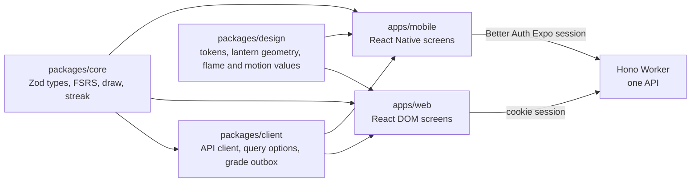

# Native mobile app

A phone app is worth building when it is better than the PWA at the two daily jobs: catching a word while the lesson is fresh, and reviewing every evening without being asked. The proof of concept in [`apps/mobile`](../../apps/mobile/README.md) showed that on iOS 26 with demo data, and [ADR 0029](../adr/0029-the-phone-app-is-expo-react-native-sharing-core.md) records the decision: Expo React Native, with screens written for the phone and everything under them shared with the web.

## Why not the September leaning

The September version of this proposal leaned to Capacitor around the existing React app. The proof of concept argued the other way. The system chrome, sheets, peek menus, haptics and widgets are what made it feel native, and a WebView can only imitate them. `packages/core` already ran unchanged under Hermes, so the cost is two sets of screens, not two products.

## Stack

Versions checked on 11 October 2026.

| Layer | Choice | Lost to it |
| --- | --- | --- |
| Framework | Expo SDK 57, React Native 0.86, New Architecture | Capacitor; a WebView shell |
| Navigation | Expo Router: native stacks, form sheets, `Link.Preview`; our own tab bar | The system tab bar (`NativeTabs`) |
| Styling | Uniwind (Tailwind v4), class names shared with the web | NativeWind v5, still a release candidate |
| Motion | Reanimated 4 and Gesture Handler; React Native Skia draws the lantern, its glow and embers | Moti, no longer maintained |
| Icons and type | Lucide and Onest, as on the web | SF Symbols and San Francisco |
| Widgets | `expo-widgets` with `@expo/ui` | `@bacons/apple-targets`, the fallback for full WidgetKit |
| Data | TanStack Query with an MMKV persister, Better Auth's Expo plugin, Lingui | — |

No Expo account is needed to build: `npx expo run:ios` builds with the local Xcode. Expo's cloud services are optional. The Apple Developer Program ($99 a year) is needed for TestFlight and the App Store.

## Sharing with the web

Product rules stay in `packages/core`. Screens keep the web's component names, so a design-system rule reads the same on both. Design values come from `packages/design`, which the web and the site import too.

## Design language

Unchanged from the web: both rooms and their colours, Onest, the lantern and every flame rule, amber meaning act, one primary per view, the reveal, the end of a review, the seven lights and Lucide icons. The phone's own rules are in [phone.md](../design/system/phone.md); the moments it shares with the web and the site are in [motion.md](../design/system/motion.md) and [brand.md](../design/system/brand.md).

Decided in the proof of concept: the pill in Liquid Glass, the title in the top bar, the lit room on Today, plate grades, Onest everywhere, display type in a 1.2 line box, and no Undo toast while grading.

Decided in the design-vision session on 11 October:

- **What the phone is for.** It leads the daily jobs, and setup stays on the web ([ADR 0030](../adr/0030-the-phone-leads-the-daily-jobs-and-setup-stays-on-the-web.md)).
- **Review.** Grades 80 pt and nearly square, a flat X, pull the top bar down to end, swipe from the start edge to undo one grade, the spark from the hood after a grade, the end's light reaching the screen's edges, and a haptic for every touch that changes state.
- **Navigation.** You holds Insights, the reminder and theme, Activity and Settings; Archived closes Library. Pages push from the side, tasks rise as sheets, a review covers the screen. Capture moves to the bottom of the screen.
- **Shared moments,** on the web and the site too ([lit design language](lit-design-language.md)): the wick on reveal, numbers that roll, the end lighting the room, the pool following the hour, sound only at the goal and off with one setting, and the tilt highlight on Today's lantern on the phone.
- **Outside the app.** One widget in two sizes (Lantern small, Week medium), the Lock Screen ring, Add a word and Review controls, one plain reminder, no Live Activity for now.
- **Share to Lymi.** A Lymi sheet inside the share sheet, so the learner never leaves the app they were reading. The page title becomes the card's source.

Still open, with options to compare:

- **Tabs and capture.** Whether Explore takes a fourth tab, and whether capture sits beside the pill or in its middle. The pill keeps the proof of concept's styling.
- **Add a word.** How several words in a row and the optional fields work on a phone. The pattern to beat is Reminders' Return-adds-the-next with Linear's chips above the keyboard.
- **Widget actions.** The widgets show state but offer no action. The medium size may carry Add a word and Review as two links.
- **Controls.** Their look, and whether Review shows the count and the goal. Controls take a custom symbol, a title and a value; there is no ring.
- **Choosing the deck when sharing.** Apple's on-device model does not support Estonian, Ukrainian or Russian, and its language detector has no Estonian, so the pick likely comes from the last deck used, the deck languages, and the server.
- **A faint ember at the thumb.** Try it after a grade, against the spark alone.

## Native features, in order of value

1. **Widget and Lock Screen.** Built in the proof of concept; two sizes chosen.
2. **Share to Lymi** from Safari, Notes or a transcript, the biggest win for capture.
3. **Reminders** at a chosen time, with no streak pressure.
4. **Controls:** Add a word and Review, for Control Center, the Lock Screen and the Action button.
5. **Shortcuts and Spotlight:** "Start review", "How many are due", find a card from search.

Not doing for now: a Live Activity during a review, grading from a widget, Siri by voice, StandBy and the Watch.

## Delivery

Done: the base, shared design values, the shared client and sign-in (steps 1 to 4 of the first outline).

1. **TestFlight 1, the daily loop.** Real data for Today, Review and Library (#504); craft foundations (#506); the phone design system, Add a word and keyboard-following inputs (#505); the widget (#508); a small You; a device build and TestFlight (#507). The test: the PWA leaves the Home Screen for a week and is not missed.
2. **TestFlight 2, outside the app.** Share to Lymi (#509), reminders (#510), controls, Insights and Activity, and the card menu in a review.
3. **The App Store.** Welcome, Explore, Sign in with Apple (#528), joining and leaving shared decks, Settings in full, and the listing (#492).

## Risks

- **Two sets of screens.** Shared packages and the parity rule keep logic in one place, but every screen is built twice.
- **Taps dropped during animations in the debug build.** Settle this in step 8 before any performance claim.
- **Young APIs.** `expo-widgets` is months old.

## Sources checked

- [Expo SDK 57](https://docs.expo.dev/versions/v57.0.0/), [Widgets](https://docs.expo.dev/versions/latest/sdk/widgets/), [Glass effect](https://docs.expo.dev/versions/latest/sdk/glass-effect/), [Monorepos](https://docs.expo.dev/guides/monorepos/), [Pricing](https://expo.dev/pricing)
- [Uniwind theming](https://docs.uniwind.dev/theming/global-css)
- [Better Auth Expo integration](https://www.better-auth.com/docs/integrations/expo)
- [Lingui with React Native](https://lingui.dev/tutorials/react-native)
