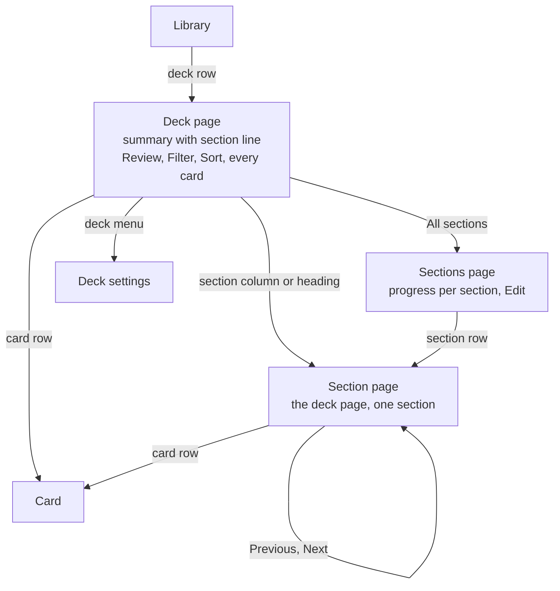

# Section pages

A learner should see how each section of a deck is going and open one section's cards without losing the deck's full list. Today a deck shows sections as one block in its summary ("Every section is open", Go to section) and as headings in the card list. On 19 October 2026 Kateryna found the block clunky on the phone. Progress per section is hard to read, and how a section opens is confusing.

The direction is a section line in the deck's summary, a page for each section, and one Sections page. The deck page keeps every card with Filter, Sort and Select. A section page is the deck page narrowed to one section and built from the same code, so neither page can do something the other can't.

Not decided: whether owners select several sections at once, what members see on the Sections page, and where deck Insights lives. See [Open questions](#open-questions).

## Evidence

The phone prototype ran four rounds on 19 October 2026 with Kateryna's Eesti A1 · Words, which has 14 sections and 501 cards. Screenshots are on [Lymi Sections IA](https://claude.ai/artifact/K2uage4VYhDojV1nYYsM2q).

- A deck page that showed only sections, as a contents list or a picker, hid every word behind a tap. Seeing every word at once with Filter is what she uses most.
- She liked one column per section, filled to what is known. A wrapping grid for 20 or more sections looked wrong, so she asked for one line that scrolls.
- The Sections list should use the rings from the deck's section headings, not small bar charts.
- Her biggest worry is consistency. A section can be renamed, archived and have its cards selected, and the section page has to offer those the same way the deck page does.

## The pages

Library has two levels below it. Back goes up one level. Previous and Next move sideways between sections.

| Page | Shows | Its ⋯ menu |
| --- | --- | --- |
| Deck | To review, cards and the state bar; the section line and what opens next; Review; Filter, Sort and every card grouped by section | Unchanged: Add a card, Smart add, Share, Move to series, Export, Select cards, Deck settings, Archive deck |
| Sections (new) | Sections learned and to review; the section line at full height; a row per section with its ring, known of total, to review and percent; How sections open; Archived sections | Edit for the owner: reorder, rename, archive, New section |
| Section (new) | Percent known, the state bar and what opens next; Review this section, or Start anyway while it waits; recall, coming back and often forgotten; Filter, Sort and the section's cards; Previous and Next | The section's actions, below |

**A section's actions.** Review this section when cards are due, Start anyway while the section waits, then for the owner Add card here, Select cards, Rename section, Reorder sections and Archive section. A member gets Review this section, Start anyway and Select cards. These are today's heading menus on both apps, plus Select cards.

**The section line.** One column per section, filled with known and learning. A few sections share the width. Past what fits, each column keeps a minimum width and the line scrolls, opening on the learner's current section with a fade on the edge that has more. The current column carries a tick where the next section opens. A tap opens that section's page.

**What opens next.** One sentence under the line, in the four states `SectionProgress` has today:

| State | Sentence |
| --- | --- |
| The next section waits | Lesson 15 opens when you know 36 of 45 in Lesson 14. 33 to go. |
| Enough is known, some cards haven't come up | Lesson 15 opens once the last 4 cards of Lesson 14 come up in review. |
| The next section is ready | Lesson 15 is ready, with Start Lesson 15 |
| Every section is open | Every section is open. |

**A section that waits.** Its page shows its cards dimmed, as the deck list does, the sentence for what opens it, and Start anyway in place of Review.

**Cards with no section.** They get a page like any section, named No section, as the last column and the last stop in Previous and Next. It appears only while such cards exist, and its menu has only Select cards. The deck list already groups them under No section.

## Three rules

1. **One card list, two scopes.** The deck route and the section route render one screen that takes `{ deckId, sectionId? }`. Summary, Review, Filter, Sort, rows, long-press menus, Select cards and the selection bar are the same code. A section scope is the deck list with its Section filter fixed and hidden, through `filterRows` and `groupRows` in `packages/client/src/deck-list.ts`.
2. **A page's ⋯ acts on what the page is.** One function builds a section's actions. The section page's ⋯, the section heading's ⋯ and its long press all call it, so the rows and their order match everywhere.
3. **One place for sections.** The Sections page is the overview for everyone and, with Edit, where the owner manages sections. It replaces the manager in deck settings on the web (`/library/$deckId/settings#sections`) and the owner's Sections page on the phone (`library/sections?id=`).

## Phone and web

Both apps get the same pages and routes and follow the same rules. Layout and input differ, as [PRODUCT.md](../../PRODUCT.md#surfaces) asks.

This breaks the web-first default on purpose: the phone leads the screens. The clunky block is a phone-width problem, and checking progress and reviewing one section are daily jobs the phone leads. The shared parts come first because both apps need them. Section links, the opening rules and the stats are rules of the deck, so a link copied on the phone or Go to section in ⌘K must open on the web. The web gains as much from one place to manage sections, since today it hides them in deck settings.

The web may not need the Sections page as a separate destination. A laptop's deck page is wide enough to show every section beside the list, so the same URL can show the overview there.

| | Phone | Web |
| --- | --- | --- |
| Routes | `library/[deck]`, `library/[deck]/sections`, `library/[deck]/sections/[section]` | `/library/$deckId`, `/library/$deckId/sections`, `/library/$deckId/sections/$sectionId` |
| Moving | Pages push from the side with a named back | Browser back; ⌘K gains Go to section |
| Section line | Scrolls under a thumb | Fits more columns before it scrolls; arrow keys move along it |
| A card | Opens as its own page | Opens in the side panel beside the list, with J and K, on deck and section pages |

## Shared code

The scope type, `sectionActions(section, role)` and, later, a section stats query live in `packages/client`. Each app draws them with its own components under matching names. The phone's `[deck].tsx` becomes `CardListScreen(scope)` and the web's `DeckDetailView` takes a scope. Both gain `useCardSelection`, `SectionLine` and `OpeningLine`, which replaces `SectionProgress`. Card writes are already shared hooks on the phone (`useCardBatch`, `useMoveToSection`, `useMoveToDeck`, `useCardMenu`), so selection only needs its state and action list moved into one hook.

Two checks keep it that way. A unit test checks that every surface gets the same section action ids in the same order. One verify flow filters, selects two cards and archives them on a deck page and on a section page, then reads the stored state.

## Delivery

Step 1 and the stats endpoint from step 5 come first, since both apps need them. The phone then ships steps 2 to 5, and the web follows with its own layout through a linked issue.

1. **Scope the deck page.** One screen that takes a scope, selection in one hook, and `sectionActions` in `packages/client`. No visible change. It gets its own pull request, so the risky part is reviewed alone.
2. **The section line** replaces the section block in the deck's summary, with all four opening sentences.
3. **The section page**, including No section and waiting sections, with the stats the server has today: known, learning, new and due.
4. **The Sections page** takes over section management from deck settings.
5. **Section stats.** Recall and often forgotten per section, from a new endpoint that deck Insights can use later.

## Open questions

- **Selecting sections.** Should owners select several sections to archive or merge them, or is Edit enough?
- **Members.** Members see progress without Edit. Should How sections open show to them as read-only text?
- **Deck Insights.** A tab on the deck (Words, Insights, members) or a link from the summary? The section page's recall block is the small version either way.
