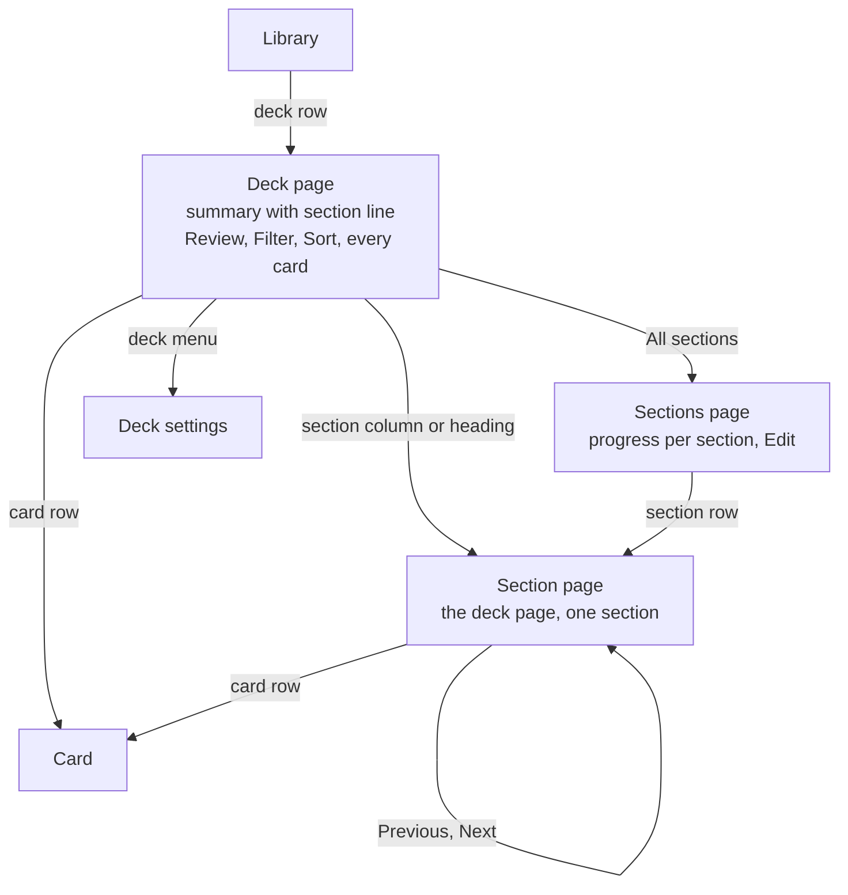

# Section pages

A learner should see how each section of a deck is going and open one section's cards without losing the deck's full list. Today sections show as one block in the deck's summary ("Every section is open", Go to section) and as headings in the card list. Kateryna's verdict on the phone, 19 October 2026: the block reads clunky, progress per section isn't clear, and how a section opens is confusing.

The direction is a section line in the deck's summary, a page for each section, and one Sections page. The deck page keeps every card with Filter, Sort and Select. A section page is the deck page narrowed to one section, built from the same code, so neither page can do something the other can't.

Not decided: whether owners select several sections at once, what members see on the Sections page, and where deck Insights lives. See [Open questions](#open-questions).

## Evidence

The phone prototype ran four rounds on 19 October 2026, on Kateryna's Eesti A1 · Words (14 sections, 501 cards). The page with screenshots is [Lymi Sections IA](https://claude.ai/artifact/K2uage4VYhDojV1nYYsM2q).

- Showing only sections, as a contents list or a picker, lost what she uses most: every word in one view with Filter.
- She liked one column per section, filled to what is known. A wrapping grid for 20 or more sections looked wrong; she asked for one line that scrolls.
- The Sections list should use the deck headings' rings, not small bar charts.
- Her main worry is consistency: a section page must offer the same actions, the same way, as the deck page.

## The pages

Two levels sit below Library. Back goes up one level. Previous and Next move sideways between sections.

| Page | Shows | Its ⋯ menu |
| --- | --- | --- |
| Deck | To review, cards and the state bar; the section line and what opens next; Review; Filter, Sort and every card grouped by section | Add a card, Smart add, Share, Move to series, Export, Select cards, Deck settings, Archive deck. Unchanged. |
| Sections (new) | Sections learned and to review; the section line at full height; a row per section with its ring, known of total, to review and percent; How sections open; Archived sections | Edit for the owner: reorder, rename, archive, New section |
| Section (new) | Percent known, the state bar and what opens next; Review this section; recall, coming back and often forgotten; Filter, Sort and the section's cards; Previous and Next | Add card here, Select cards, Rename section, Reorder sections, Archive section |

**The section line.** One column per section, filled with known and learning. Few sections share the width. Past what fits, each column keeps a minimum width and the line scrolls, opening on the learner's current section with a fade on the edge that has more. The current column carries a tick where the next section opens, and a sentence under the line says it: "Lesson 15 opens when you know 36 of 45 in Lesson 14. 33 to go." A tap opens that section's page.

## Three rules

1. **One card list, two scopes.** The deck route and the section route render one screen that takes `{ deckId, sectionId? }`. Summary, Review, Filter, Sort, rows, long-press menus, Select cards and the selection bar are the same code. A section scope is the deck list with its Section filter fixed and hidden, using `filterRows` and `groupRows` from `packages/client/src/deck-list.ts`.
2. **A page's ⋯ acts on what the page is.** One function builds a section's actions. The section page's ⋯, the section heading's ⋯ and its long press all use it, so the rows and their order match everywhere.
3. **One place for sections.** The Sections page is the overview for everyone and, with Edit, the owner's place to manage sections. It replaces the manager in deck settings on the web (`/library/$deckId/settings#sections`) and the owner's Sections page on the phone (`library/sections?id=`).

## Phone and web

Same pages, same routes, same rules; only layout and input differ, as [PRODUCT.md](../../PRODUCT.md#surfaces) asks. By default the web ships first and the phone follows through a linked issue.

| | Phone | Web |
| --- | --- | --- |
| Routes | `library/[deck]`, `library/[deck]/sections`, `library/[deck]/sections/[section]` | `/library/$deckId`, `/library/$deckId/sections`, `/library/$deckId/sections/$sectionId` |
| Moving | Pages push from the side with a named back | Browser back; ⌘K gains Go to section |
| Section line | Scrolls under a thumb | Fits more columns before scrolling; arrow keys move along it |
| A card | Opens as its own page | Opens in the side panel beside the list, with J and K, on deck and section pages |

## Shared code

The scope type, `sectionActions(section, role)` and, later, a section stats query live in `packages/client`. Each app draws them with its own components under matching names: the phone's `[deck].tsx` becomes `CardListScreen(scope)`, the web's `DeckDetailView` takes a scope, and both gain `useCardSelection`, `SectionLine` and `OpeningLine`, which replaces `SectionProgress`. Card writes are already shared hooks on the phone (`useCardBatch`, `useMoveToSection`, `useMoveToDeck`, `useCardMenu`), so selection only needs its state and action list moved into one hook.

Consistency gets checked rather than trusted. A unit test checks that every surface gets the same section action ids in the same order. One verify flow filters, selects two cards and archives them on a deck page and on a section page, then reads the stored state.

## Delivery

1. **Scope the deck page.** One screen that takes a scope, and selection in one hook. No visible change. Its own pull request, so the risky part is reviewed alone.
2. **The section line** replaces the section block in the deck's summary.
3. **The section page**, with stats the server has today: known, learning, new and due.
4. **The Sections page** takes over section management from deck settings.
5. **Section stats**: recall and often forgotten per section, from a new endpoint that later feeds deck Insights.

## Open questions

- **Selecting sections.** Should owners select several sections to archive or merge them, or is Edit enough?
- **Members.** Members see progress without Edit. Should How sections open show to them as read-only text?
- **Deck Insights.** A tab on the deck (Words, Insights, members) or a link from the summary? The section page's recall block is the small version either way.
