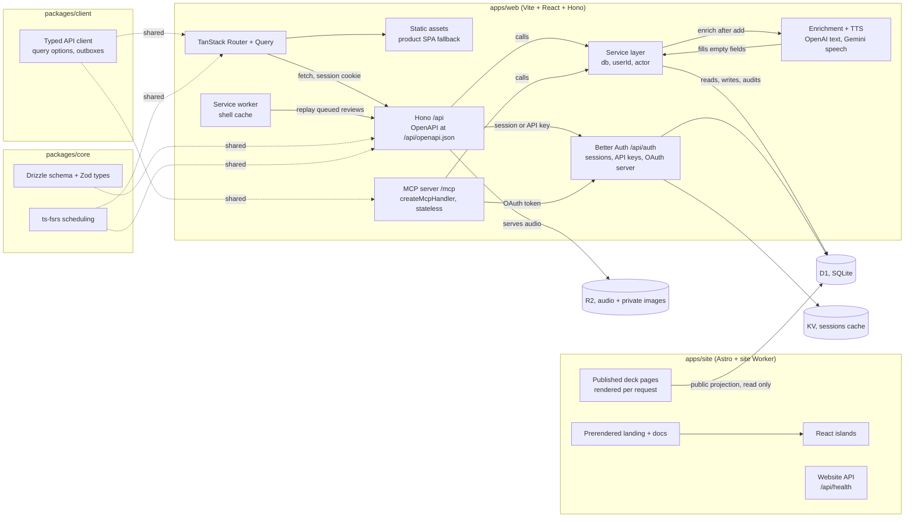

# Technical stack

**Status:** Agreed 5 September 2026, integrations layer decided the same day. Edit in place as decisions change. Vocabulary is in [CONTEXT.md](../CONTEXT.md).

Everything runs on Cloudflare. An Astro site and narrow Worker serve the public website and docs on `lymi.app`. A separate Vite React and Hono Worker serves the product, API, auth and MCP server on `my.lymi.app`. Interactive public sections hydrate as React islands, while the private product remains a client-rendered PWA that behaves like a native app on the phone and like a keyboard-driven web app on the desktop. Shared logic lives in a package the phone app in `apps/mobile` imports unchanged.

## Shape



## Decisions

### Clients: prerendered Astro website plus a client-rendered React PWA

The public site at `lymi.app` is rendered by Astro. Landing and documentation are prerendered and ship useful HTML and canonical metadata before JavaScript runs; interactive React components hydrate as islands. Explore (`/explore`), published deck pages (`/explore/<slug>`) and their preview images (`/explore/<slug>/share.png`), the exam pages, and each supported language's page (`/languages/<name>`), in each locale, and the runtime sitemap that lists them and every deck are the only routes Astro renders per request, from the public projection of D1 in `packages/core/src/catalog.ts` ([ADR 0016](adr/0016-public-catalog-pages-render-on-the-public-worker.md)). A supported language's page is a row in `LANGUAGE_PAGES` (`apps/site/src/lib/language-pages.ts`) and a view of its own: one `/languages/[language]` route per locale resolves its decks and draws the shared shell in `LanguagePage.astro`, and routes, the sitemap and the site links read the same table. A narrow Worker serves the assets, those pages, the legacy redirects and a versioned health endpoint. It has no product shell, authentication or PWA behavior.

The signed-in product at `my.lymi.app` is still a client-rendered single-page PWA. It sits behind a login, so a static shell remains the right fit for fast offline starts. TanStack Router gives typed routes and a proper mobile navigation model. TanStack Query, persisted to IndexedDB as JSON, is the cache that makes the app usable on a train; a whole library's cards outgrow localStorage and would block the page on every write. `/today` is the product home and `/app` redirects there. The product root sends a valid session to Today and a signed-out visitor to sign-in, preserving safe product deep links through authentication.

`vite-plugin-pwa` handles the manifest and Workbox service worker on the product origin only. The app captures Chromium's install event for its in-app button and shows manual instructions on browsers that do not expose one. The shell is precached. The service worker updates itself and reloads the page, and an open app checks for a new one whenever it comes back to the front, so a tab or installed app left open does not keep running code older than the API it calls. Data goes through Query's cache plus a grade outbox in localStorage. A grade enters the outbox before it is sent, so the review moves to the next card without waiting for the server, and the outbox replays queued grades in order when the connection returns and keeps each sent grade until a fetched log holds it. The review draws its next card on the device from `GET /api/review/draw` and that outbox, so a reload, offline grading and Undo land on the card the server would pick ([ADR 0019](adr/0019-the-review-queue-is-a-deterministic-weighted-draw.md)). Card and deck writes (add, edit, archive and restore) queue the same way in a write outbox, with ids made on the device. They replay in order alongside grades, show in the cached lists until they land, and survive reloads, deploys and a lapsed session ([ADR 0023](adr/0023-offline-writes-queue-on-the-device-and-replay-in-order.md)). The public deployment neither generates nor serves a product service worker.

Review reminders use standards-based Web Push with VAPID, sent directly by the product Worker. Subscriptions and local reminder times are per device in D1. One UTC Cron Trigger runs every 15 minutes, evaluates each device in its stored IANA timezone, sends only when active cards are due, and atomically records the local date before delivery so retries do not duplicate a reminder. See ADR 0006.

The deployment boundary is accepted in [ADR 0009](adr/0009-public-website-and-product-deploy-separately.md). The permanent origin and authentication contract remains in [ADR 0008](adr/0008-public-website-and-product-use-separate-origins.md).

### Feels native on the phone

This is a design requirement with a technical checklist:

- `display: standalone`, `theme-color` per theme, splash icons, iOS `apple-mobile-web-app-*` meta.
- `100dvh` layouts, safe-area insets, no body scroll, scroll containers per screen.
- Bottom drawers via Base UI's Drawer, page transitions via the View Transitions API with a Motion fallback.
- `touch-action: manipulation`, 44 px targets, 16 px inputs, haptics via `navigator.vibrate` where available.
- Keyboard shortcuts and a command palette on desktop; the same routes, a different shell.

The bar is "could be mistaken for native." Every screen is checked on a real iPhone in standalone mode before it ships.

### Phone app: Expo React Native, sharing Lymi's packages

`apps/mobile` is an Expo SDK 57 React Native app with Expo Router, Uniwind (Tailwind v4 class names shared with the web), Reanimated with Gesture Handler, Lucide and Onest, and Home Screen widgets through `expo-widgets`. It imports `packages/core` unchanged, and `packages/client` with its own origin, session headers and storage: `my.lymi.app`, Better Auth's cookie, SecureStore for the session and MMKV for the query cache and outboxes. Its screens read the same query options as the web and render them with native components. Design values come from `packages/design`, which the web and the site import too. It lost to Capacitor around the existing React app, which keeps every screen a WebView. [ADR 0029](adr/0029-the-phone-app-is-expo-react-native-sharing-core.md) has the decision and [the proposal](proposals/native-mobile-app.md) the delivery outline.

The phone reaches iOS's entry points through Swift it owns: Share to Lymi and the Control Center controls are `@bacons/apple-targets` extensions, and the App Intents sit in the controls' `_shared` folder, which the app compiles too, because a control's intent runs in the app; Siri, Shortcuts and Spotlight's intents compile only into the app, or iOS runs Cards due in the extension. Each intent opens the app's own link from inside the app, since `OpenURLIntent` cannot open a custom scheme. The app icon's long-press actions use `expo-quick-actions`. So the signed-out path is the one links already take. `expo-app-intents`, which declares intents from JavaScript, arrives with SDK 58 and is alpha; `expo-widgets` does not cover controls.

Apps built with the iOS 27 SDK must adopt the scene life cycle or iOS stops them at launch. `plugins/with-scene-delegate.cjs` gives SDK 57's template SDK 58's scene delegate, Expo's `ExpoAppSceneDelegate`, which starts React Native in the scene's window and forwards links, user activities and quick actions to the app delegate; it also hands a launching quick action to `expo-quick-actions`, which reads one only from launch options. Upgrading to SDK 58 for its template lost because it also moves React Native from 0.86 to 0.88; the plugin goes with that upgrade.

### UI: Tailwind v4 + shadcn/ui on Base UI, tokens in packages/design

Tailwind v4 reads design tokens as CSS variables in OKLCH, defined in `packages/design/tokens.css` and imported by the web's and the site's `styles.css`; DESIGN.md's frontmatter and the phone's hex values are generated from them. Interactive primitives are shadcn/ui components on Base UI, copied into `apps/web/src/client/components/ui` and restyled with Lymi's tokens rather than shadcn's theme variables; `cn` merges their classes. Motion handles the lantern and transitions. [ADR 0017](adr/0017-interface-primitives-are-shadcn-components-on-base-ui.md) owns the component boundary.

Alternative considered: hand-built primitives on `<dialog>` and the `popover` attribute with vaul for the drawer. That was the first version. vaul stopped being maintained, and four separate open-and-close implementations disagreed on scroll lock, focus return and which device got which shape.

### Type: self-hosted Onest, sizes in rem

Both apps bundle variable Onest from `@fontsource-variable/onest`: Latin (34 KB), Latin extended (28 KB), Cyrillic (16 KB) and Cyrillic extended (11 KB) woff2 files, each behind a `unicode-range`, so a page downloads only the scripts it renders. The `@font-face` rules declare weights 400–600, the range the interface uses. The Latin file is preloaded, and the product's service worker precaches all four with the shell. No font request leaves the origin.

`--font-sans` puts "Onest Fallback" after Onest: local Arial, or the metric-compatible Liberation Sans, resized so text laid out before the swap already fills Onest's box. The values come from fontTools, run against the shipped Latin file and macOS Arial. `size-adjust` is Onest's average advance width over Arial's, weighted by English letter and space frequency. The ascent, descent and line-gap overrides are Onest's typo metrics (970, −305 and 0 per 1000; `USE_TYPO_METRICS` is set) divided by that adjustment. There are two faces, measured at weight 400 and 500 and split at 450, because Onest widens as it gets heavier and the card term is set at 500. Re-measure when an upgrade changes the font files.

Text sizes are rem, so the reader's default font size scales the type; spacing and radii stay px. Form controls on phones are `1rem`, which is 16 px on iOS, where a smaller size makes Safari zoom on focus.

Alternative considered: the Google Fonts stylesheet with `display=swap`. It cost a connection to two third-party origins before first text, and the service worker could only cache it at runtime. With no metric-matched fallback, the term on the card reflowed when the font arrived.

### Servers: two Cloudflare Workers, with Hono on the product

The public `lymi-site` Worker is built by `@astrojs/cloudflare`. Assets and prerendered pages are served before the Worker runs; `src/worker.ts` answers `/api/health` and `/api/beta` and hands every other request to Astro's handler, which renders a published deck page or the 404 page. A deck page is `public, max-age=300` with an ETag of slug, revision, locale and Worker version, and it never reads a cookie. The product `lymi` Worker routes `/api/*`, `/api/auth/*`, `/mcp`, OAuth discovery and product navigations through Hono before its SPA asset fallback. Product documentation paths redirect to `lymi.app`; unknown product paths can never render public content. Local browser tests run the two Workers on separate loopback origins.

Alternative considered: Cloudflare Pages plus Functions for the website. A Worker with static assets keeps both deployments on the same platform, supplies version metadata and supports the narrow beta action without another service.

Alternative considered for deck pages: a prerendered shell per locale that the Worker fills from D1 with `HTMLRewriter`. It keeps the build fully static, but every title, description, JSON-LD block and card row would be written twice, once in Astro and once as string rewriting in the Worker, and localized copy would have to be shipped to the Worker separately. The Cloudflare adapter renders the same Astro and React components per request and keeps every other page prerendered.

### Preview images: resvg on the site Worker

A deck page's `og:image` is its own: the Worker renders an SVG of the lockup, the deck's name, its facts and a pool of its tray hue to PNG with `@resvg/resvg-wasm`, and answers it with the page's cache rules and a validator of the same content hash. The renderer is a 2.5 MB Wasm module in the bundle; Onest travels beside it as a TTF from Google Fonts (`src/fonts`, OFL), because resvg reads no woff2 and the Worker has no system fonts. The SVG builder in `lib/deck-share.ts` measures and wraps the name itself, since resvg breaks no lines; its widths are estimates, so it errs wide.

Alternatives considered: rendering at publish time into R2 from the product Worker, which puts an image pipeline on the write path for a file nobody may ever fetch, and Browser Rendering, which is a paid binding and slower per image than a page. A generic site image for every deck was the state before; it gave a shared deck no name in the preview.

### Data: D1 with Drizzle

D1 is SQLite at the edge. Drizzle gives a typed schema shared with the client and generates migrations. One database for now, tenanted by `user_id` from day one so adding users later is a policy change, not a migration. Review history is append-only.

Language lives on the card, not the deck. `cards.language` is nullable; a deck may carry a default as a convenience. Detection fills it in at capture time and a chip lets you correct it. Cards without a language get no audio and no language-specific enrichment, and everything else works the same, so decks can mix languages or hold content that is not vocabulary at all.

Later option: a Durable Object per user holding its own SQLite, which turns sync and offline into a solved problem. Not needed for one user.

### Auth: Better Auth on the Worker

Better Auth runs on Workers, supports D1 natively as of 1.5, and does social login plus sessions, API keys for the public API, and an Expo plugin for the React Native app later. Three ways in: Continue with Apple, Continue with Google, and an email address with a password. The phone uses the native Sign in with Apple sheet, which App Store guideline 4.8 requires beside Google: its native sheet posts Apple's ID token to `/sign-in/social` with the raw nonce whose hash it gave Apple, and a token without a matching nonce is refused. The native provider is registered only once `APPLE_APP_BUNDLE_IDENTIFIER` is set. Web sign-in also needs the Services ID in `APPLE_CLIENT_ID` and the signing key; it signs a five-minute client secret for each OAuth flow and accepts Apple’s cross-site POST callback before resuming the original destination. The Services ID is grouped with the native App ID so both identify the same Apple account. Deleting an account that signs in with Apple revokes the app's Apple grant, which Apple requires: the phone's fresh sign-in returns an authorization code, which the Worker trades for a refresh token and revokes with a client secret signed by the Sign in with Apple key in `APPLE_TEAM_ID`, `APPLE_KEY_ID` and `APPLE_PRIVATE_KEY`; without them the account is still deleted and the grant stays. Sign-up is open to anyone: Lymi is in public beta, and no allowlist stands in front of either door.

Known issue to watch: a reported bug where sessions expire after five minutes with D1 and KV. Test session refresh before relying on it.

Cloudflare Access was considered as an interim and rejected. Better Auth is built first so the API and MCP tokens have one auth system from day one.

Three ways in, one system:

| Caller | Credential | Better Auth piece |
| --- | --- | --- |
| The web app | Session cookie | core |
| curl, scripts, Claude Code | Personal API key, made and revoked in Settings | `apiKey` plugin |
| Claude Desktop, Codex, other MCP clients | OAuth 2.1 access token | `@better-auth/mcp` plugin, which makes this Worker the authorization server |

Claude Desktop and Codex both require OAuth for remote MCP servers, which is why a bearer key alone was not enough. `@better-auth/mcp` (Better Auth 1.7) serves the `.well-known` metadata, the consent page and JWT access tokens. The Worker checks tokens against its own JWKS with no database hit. Cloudflare's `workers-oauth-provider` was the earlier plan and is no longer needed.

Every key and every OAuth grant carries one scope, `read` or `write`. Write allows creating, editing and archiving decks and cards. Nothing an integration holds can grade a review.

An API key may make 600 requests before the `apiKey` plugin answers 429 with `Retry-After`. The plugin clears the count only after a full minute without a request, so the limit is 600 calls per unbroken run rather than per minute. Keys of accounts on `PUBLISHER_EMAILS` skip the limit, because a publishing run makes thousands of calls without pausing; `principal.ts` syncs each key's `rateLimitEnabled` with the list on use, so it holds for keys made before an account was added.

Password accounts are Better Auth's own credentials, hashing and verification tokens ([ADR 0003](adr/0003-better-auth-is-the-oauth-server.md)). Four rules shape them.

What Lymi asks of a password lives in `@lymi/core`, so the box and the route cannot disagree: at least ten characters, no composition rules, and a screen against the passwords a guesser opens with, anything built from the learner's own address, and anything built from the word Lymi. Requiring a capital and a symbol is left out deliberately — it pushes people towards `Passw0rd!`, which is shorter and more guessable than three plain words. `server/password-rules.ts` is what makes the rule true rather than a suggestion, because these endpoints take a form-encoded body that no form of ours produced.

An address is proven before it grants anything. `requireEmailVerification` means sign-up issues no session and a confirmation link is what signs the learner in, and it also makes Better Auth answer a taken address exactly as it answers a free one. Sign-up, resend and reset therefore return the same confirmation whatever the address is; the address owner, not the requester, is told what actually happened.

A password is retired wherever it was never proved. Anyone holding a join link can sign up with someone else's address and choose the password, so confirming, which proves only the address, is not allowed to bless it: a sign-up binds itself to the browser that made it with a signed cookie, and a confirmation from anywhere else drops the credential, forgets the name and photo that sign-up claimed, and mails the owner a link to set their own password. The Google or Apple sign-in that first links an account does the same when the account had not proved its address before the link, and leaves a password the owner had already confirmed alone; later sign-ins link nothing and retire nothing, so Continue with Google never locks the owner out of their own account. Both deletions are audited. A reset asked for a Google account emails the door rather than a reset link, so a reset can never mint a password on an account Google owns.

A learner who confirms on a different device from the one they signed up on pays for this: the password goes and a reset link arrives. That is the cost of not being able to tell them apart from someone who typed their address.

Rate limits are per address as well as per caller. Better Auth's own limiter counts requests per path and IP, which leaves one mailbox open to a flood from many machines, so `server/auth-rate-limit.ts` meters sign-in, sign-up, resend and reset on both keys in KV and answers 429 with the seconds to wait. It reads a form-encoded body as well as JSON, because Better Auth accepts both on these endpoints, and refuses a body it cannot read rather than letting it past unmetered. A sign-in that worked spends nothing, so guessing at a known address cannot lock its owner out. Sign-up holds every answer for a fixed floor, because refusing an address with no invitation is faster than admitting one and the bodies are otherwise identical. The per-caller budget is off on loopback, where every local request shares one address.

Transactional email has a daily ceiling of its own in KV, under the provider's quota, so a spread of machines inside the per-caller budgets cannot spend the day's allowance and leave a real learner's reset undelivered.

### Analytics: Workers Analytics Engine and PostHog EU

The product Worker writes request counts, status classes and timings to `lymi_requests`, fixed product action labels and counts to `lymi_events`, and each outside call's outcome with the production canary's verdicts to `lymi_health`. Route patterns replace requested paths, and no dataset receives account identifiers, client names, card content or query strings. Separate datasets keep high request volume from sampling product actions under the same index. The bindings are optional in local development and omitted from product previews, whose activity is synthetic.

PostHog EU project 292417 measures product behavior on both production origins. The shared catalog in `packages/core/src/analytics.ts` validates event properties; browser and Worker adapters discard SDK context and undeclared fields. Opaque account IDs join browser, HTTP, MCP and Workflow outcomes without names, email addresses or card content. [The instrumentation guide](analytics.md) owns consent, identity, event meanings and extension rules.

Analytics store nothing on the device, so neither site shows a consent banner. The public site uses PostHog's cookieless mode: PostHog hashes a visitor from the day, address, host and browser, then drops the address. Signed-in product analytics are keyed to the opaque account ID and rest on legitimate interest: they are on unless the learner objects by email, which an operator records on the account. Browsers send through `/ingest` on their own origin, where the Worker adds Cloudflare's country and forwards to PostHog; PostHog's own geolocation stays off. Links on the public site carry a visit's source to sign-up in the address. The SDK uses memory persistence, manual page views and explicit events; replay, click autocapture, surveys and flags remain disabled. A consent banner with six-month choice cookies was the alternative that lost: it covered the first screen and left most visits and new accounts unmeasured.

Unexpected HTTP and MCP failures, browser exceptions, exhausted enrichment, internal import and export failures, failed lesson reads and failed cron jobs reach Error Tracking. Reports discard exception messages, request URLs, SQL, SDK context and source snippets, retaining classes, compiled script names, line numbers and fixed route patterns. Delivery failure cannot change a product response; HTTP uses `waitUntil`, and Workflows finish delivery inside their durable step. The web uploads no source maps. The phone reports uncaught JavaScript errors and unhandled promise rejections from release builds against production only, through the same `/ingest` proxy and scrubber, tagged `surface=phone` with its app version, build and running update ID, and joined to the learner only as their product analytics are (`docs/analytics.md`). It keeps unsent reports and events, already scrubbed, in a file on the device, so a crash that closes the app is sent on the next launch, while usage events wait for their account's analytics setting; the SDK's stored distinct ID, anonymous ID and session are never written there, so only unsent events carry the ID they were captured under. It keeps Hermes frames' bundle name and chunk ID, because its stacks are unreadable without source maps, which Phone beta uploads for over-the-air updates and EAS uploads from each iOS Release binary's bundle phase ([phone-release.md](phone-release.md)). Production alerts are email from Cloudflare and PostHog, never a GitHub issue, which arrived too late and said too little to act on. A handled failure is invisible to Error Tracking, as on 17 October 2026 when every AI call failed and none raised, so a 15-minute canary calls each outside service and Cloudflare alerts on its verdicts, on failed real calls and on 5xx responses, independently of the Worker; [operations.md](operations.md) lists every alert and what to do. A paid alerting service such as PagerDuty or Sentry was the alternative that lost: another vendor holding production data for one maintainer who already reads email.

Deleting an account erases its PostHog person at once, and its events in PostHog's weekly deletion run, through the PostHog API when `POSTHOG_PERSONAL_API_KEY`, a personal key with person write scope, and `POSTHOG_PROJECT_ID` are Worker secrets. `POSTHOG_PROJECT_TOKEN` is a public write-only ingestion token, configured in the product Worker and mirrored in `packages/core/src/telemetry.ts` for the public bundle. Neither adapter delivers events from development, loopback or isolated previews. Keep usage billing limits at $0 in the PostHog organization and review promotional add-ons at their expiry. Project reporting uses Europe/Tallinn; event timestamps remain UTC.

Public page views carry the referring host and approved campaign labels; PostHog's Web Analytics product is not configured. Page views of published decks are counted separately: the site Worker adds one to `deck_page_views` in D1 per request, by deck, UTC day and locale, for publisher reports ([ADR 0028](adr/0028-publishers-read-aggregate-reports-on-their-published-decks.md)). It skips known crawlers and stores nothing about the visitor.

### Email: rendered by the Worker, delivered by Resend

The product Worker sends every email from `notifications@lymi.app`, with replies going to `hello@lymi.app`. Services name the message kind, recipient and app language, and a kind may carry data and its own reply-to, which learner feedback uses to send a learner's note to `hello@lymi.app` answerable to them. `services/email.ts` composes each kind's text from the product's English-source Lingui catalog, except a message written for Lymi rather than for a learner, whose scaffolding is English in every locale; `server/email/template.tsx` draws it with React Email in one frame, with hex colours from `@lymi/design`'s generated palette and a dark room for clients that honour it. The plain-text body comes from the same composition. Images live in `apps/web/public/brand/email/`, drawn by `apps/web/scripts/email-images.mjs`.

Resend delivers once `RESEND_API_KEY` is a Worker secret; until then the restricted Cloudflare Email Service binding does. Resend's bounce and complaint webhook reaches `/api/email/events`, verified with `RESEND_WEBHOOK_SECRET`. Loopback development writes to an in-memory outbox instead of contacting a provider, browser tests read that outbox through a development-only route, and the local `/emails` page renders every kind with sample data and can send one to an operator through Resend. The hidden production smoke test is learner-session only and further restricted by `OPERATOR_EMAILS`; every successful send records its kind and delivery path in the audit trail without the recipient or body.

Resend won over Cloudflare Email Service because Cloudflare supports transactional email only, and Lymi's product news and learning emails are not ([proposal](proposals/email.md)). One provider for all mail also gives account email the bounce and complaint reports Cloudflare's binding does not. Lymi renders and decides; Resend never holds templates, contacts or unsubscribe state, so changing provider is the send call and the webhook. Account email and news send from separate domains so complaints about news never touch sign-in mail.

### Spaced repetition: ts-fsrs

FSRS in TypeScript, in `packages/core`, used by the client (to schedule offline) and the server (to validate and persist). Grades and intervals are the algorithm's, not invented. One 10-minute learning step sets FSRS state only; which card comes next, and when a missed card returns, is the weighted draw in `packages/core/src/draw.ts` ([ADR 0019](adr/0019-the-review-queue-is-a-deterministic-weighted-draw.md)).

### AI: enrichment plus lazy multilingual speech

**The server does not extract vocabulary from lessons. The MCP client does.** Claude Desktop or Codex already holds the transcript and a model, so it reads the lesson and calls `add_cards`. That keeps the Worker's AI to three small jobs. Enrichment fills the empty fields the card's deck allows (meaning, example, notes, pronunciation, and always the language), only those that suit the card, and leaves every field that already has text alone ([ADR 0033](adr/0033-a-deck-decides-what-enrichment-fills.md)). An import's inspection asks once for the language of every deck that neither the file, the deck's name nor its script placed, from a dozen of its terms; with no key configured, or when the call fails, those decks take the learner's usual language, and the preview asks only a learner with no cards yet. A hook draft writes nothing on the card: it is the greyed placeholder in the owner's hook editor, and becomes the hook only when the learner keeps it.

Enrichment runs in the background after an add that leaves fields unset. The learner's adds in the app enrich by default; an API key or MCP client asks per card with `enrich: true`, because an agent tending a deck in bulk should not get text it did not ask for. A field stored as `""` is a deliberate clear and is never filled by a run; asking to enrich that card reopens it. Typing "sbrigarsi" on the phone and finding the meaning there by the time you open the deck is the point. Each filled field is stored with `source: "ai"` so the UI labels it. Meanings are written in the learner's meaning language, a per-user setting, English by default. Each call carries the deck's name, description, language guide, the owner's instructions and up to five of the deck's own cards, so the AI follows the deck's form. The prompt, the language guides and an evaluation over invented cards live in `apps/web/src/server/enrichment`; a supported language's text for every AI call site lives in its own module in `apps/web/src/server/languages` and reaches the model as per-deck or per-card input, so system prompts stay static. A recorded live run in `enrichment/runs/` keeps every reply with the prompt hash and model; CI rescores it, fails when the hash no longer matches what the model reads, and compares each rule's pass rate with the run before it.

One Cloudflare Workflow per add batch does the work, alongside the import and export workflows, asking for about ten cards per model call so a lesson lands in waves rather than all at once. `cards.enrichment_status` is `working` or `failed` while a job is outstanding and null otherwise, and the reads that already load cards carry it, so each empty field can hold its space until the text lands. A run that gives up leaves its cards at `failed` and the add itself still succeeds; with no OpenAI key configured no run is queued at all and the cards stay exactly as they arrived.

A hook draft is one call per card, on demand, made when writing a hook is a tap away: after the reveal of a card with the hook offer, or as the card's menu opens. It runs at `medium` reasoning effort, which drafted as well as `high` on the learner's real cards in about half the time, and only for a word or phrase of up to three words in a language other than the meaning language, since the keyword method has nothing to sound alike in a sentence or in the learner's own language. The prompt in `services/hook-draft.ts` writes in the meaning's language and never writes what the card asks for; the server refuses a draft that does. It drafts several candidates across routes (a whole word that sounds like the term, short words chained over it, a sound inside a longer word, a compound read as its parts) and keeps the one strongest on sound, meaning, picture and natural wording, after [overgenerate-and-rank](https://aclanthology.org/2024.findings-emnlp.316/); matching only the first letters was the old prompt's weakness. The model names the meaning's language before writing, from the meaning and up to eight other meanings in the deck: the meaning language setting follows the app language, not the deck, and one meaning such as магазин cannot tell Ukrainian from Russian. The draft is kept in `cards.hook_draft` until the term or meaning changes, and a hook saved as exactly that text has source `ai`.

OpenAI remains the text-enrichment vendor, on `gpt-6-luna` with structured outputs, so a reply either parses against the schema or the step retries. It runs at `high` reasoning effort: meanings and examples were right at every effort, but lower efforts put the stress mark on the wrong syllable in IPA far more often, and `high` still writes far fewer output tokens than `gpt-5-mini` did. Claude and Gemini both write good definitions; OpenAI wins on already being the speech fallback vendor, so enrichment adds no second text credential. The model is overridable per environment with `OPENAI_TEXT_MODEL`, because the cheap tier moves faster than this document; an override must be a reasoning model, because the request always sends an effort. Speech defaults to Gemini-TTS through the Gemini API used by AI Studio, with the native ElevenLabs v4 reference voices chosen by listening in `speech-voices.ts`, including Priit for Estonian; Korean's Hyunbin was shortlisted among the library's native Seoul voices by transcription and loudness checks, then confirmed by listening against Chris, and Vietnamese's Ninh Đôn and Bokmål's Mia Starset by the same checks against Gemini. Czech, Polish and unrated languages keep Gemini. The locale is pinned because a single word is too little text to detect a language from. Gemini uses Kore by default; OpenAI and then Chirp 3 HD are runtime fallbacks. Cloud Gemini remains available when only the Google service account is configured and `aiplatform.googleapis.com` is enabled in its project. Speech prompts name the language in English ("Estonian"), never as a bare code such as `et`. The routing layer is provider-neutral, so an R2 hit does not parse credentials or call a vendor.

Every model call requires the authenticated Cloudflare AI Gateway `lymi`; missing configuration fails without calling a vendor directly. Workers AI names the gateway through its binding, while external providers require `AI_GATEWAY_URL` and `AI_GATEWAY_TOKEN`. Cloud Gemini and Chirp use the custom provider `google-cloud-tts`, whose base URL is `https://texttospeech.googleapis.com`; only Google OAuth token exchange stays direct. Requests disable gateway payload storage and caching, and external provider requests refuse redirects so credentials cannot leave the configured endpoint. Gateway logs and caching stay off, provider credentials are required, and spend limits are $50 per month overall and $30 for Anthropic; TypeSafe calls need custom token costs for budget accounting, while Cloud Text-to-Speech returns no token usage and is outside the gateway's cost budgets. TypeSafe AI is available through `custom-typesafe` at `https://api.typesafe.ai`, with its key in the gateway's encrypted store under alias `default`; lesson decisions continue to use Clef-flash. `ai/gateway.ts` owns routing for the product and the site's speech script, which runs through the product package's TypeScript runner.

### MCP: stateless handler in the product Worker

`createMcpHandler` from the Agents SDK at `/mcp`, Streamable HTTP, no Durable Object. `McpAgent` was the earlier plan and is deprecated. Authorization is the Better Auth OAuth server above.

Tools call the same service layer the REST routes call, so MCP cannot bypass product rules and every write lands in the audit log with actor `mcp`. The tool set mirrors the REST API less review grading: list, get, create, update, archive and restore decks; search, get, add, update, archive and restore cards; due counts; settings; insights. An `enrich` tool follows once the enrichment service exists. There is no delete tool because the app has no delete. Claude Desktop does not support elicitation, so the server cannot ask "are you sure". Archive being reversible is the safety. A meaning, example or pronunciation an assistant sends without naming its source is stored as `ai`, so the app never shows an assistant's text as the lesson's.

### MCP views: one bundle under the MCP Apps standard

Results a learner looks at, such as a card, a deck's progress, what is due, insights and the streak, carry a view that renders in hosts supporting MCP Apps: ChatGPT, Claude, VS Code, Cursor and others ([ADR 0026](adr/0026-interactive-mcp-results-use-the-mcp-apps-standard.md)). The view is a React app in `apps/web/src/client/mcp-app`, built by a nested Vite build in `mcp-app.build.ts` into one HTML file and imported by the Worker as `virtual:lymi-mcp-app`. Each view is a `ui://lymi/<language>/<view>-<hash>.html` resource; the hash and language are in the URI because hosts cache by it, and the server writes the learner's one catalog into the document instead of bundling three. The view has no network of its own. It reads through tool calls the host makes with the connection's grant and changes nothing; nothing it shows enters model context. `GET /api/dev/mcp-host` renders it locally against the real server.

ChatGPT's extensions sit on the same views ([`mcp/host-extensions.ts`](../apps/web/src/server/mcp/host-extensions.ts)). `open_lymi` is Lymi's home in the sidebar and beside a conversation, and opens at `/card/<id>` or `/deck/<id>` from a deep link. `mention_search` offers decks and cards to @-mention as `lymi://deck/{id}` and `lymi://card/{id}` resources, which any host can read. The app language is a native setting through `settings_read` and `settings_update`. All four are app-only, so the model never sees them; other hosts ignore the `openai/*` keys.

Alternative considered: serving the view's scripts from `my.lymi.app` and allowing that origin in the view's CSP. It keeps the HTML small, but every host would need the origin approved, and a cached document would load scripts from a newer deploy.

### Integrations: cards land as cards

A card added through the API or MCP is an ordinary card from the moment it lands. There is no proposals table and no approval step. In its place, an **Activity** view in Settings lists every write made by an integration or the AI, and you can inspect, edit or archive from there. Cards carry a `created_by` actor so Activity can filter without parsing the audit log.

Adds take one card or many. A lesson produces 20 to 40 terms, and one tool call per term is 40 model turns. A **duplicate** is a card whose normalised term and language match an active card anywhere in your decks. A duplicate is skipped, never rejected, and the response names the existing card, so re-running the same call is safe. A card with no language only matches other cards with no language.

### API: a service layer and generated docs

Route logic lives in service functions that take `db`, `userId` and `actor`. Hono routes and MCP tools are thin callers. The OpenAPI document is generated from the Zod schemas in `packages/core` and served at `https://my.lymi.app/api/openapi.json`. The documentation site at `https://lymi.app/docs` renders it without credentials through narrowly scoped CORS; `/api/docs` redirects to the public reference.

### Audio: first play, then R2

Pronunciation audio is generated only when the learner first presses play. A review card whose clip is already stored loads it as the card arrives, through `?stored=1`, which serves only the clip a play would serve and voices nothing, so a tap plays at once; a press that has to wait for speech shows the spinner at once. Cards without a language, and terms longer than 200 characters, never show the control and never call a speech provider. The Worker tries a configured native ElevenLabs voice, Gemini, OpenAI and Chirp 3 HD in that order for the languages each one publishes, stores the audio in R2, and remembers the object on the card. Gemini API audio is a 24 kHz mono PCM WAV; ElevenLabs, Cloud Gemini and the other fallbacks return MP3. `ELEVENLABS_SPEECH_VOICES` can override the built-in voice IDs by locale or root, or set a language to `null` to use Gemini. Brazilian Portuguese has its own locale entry; it never overrides European Portuguese. Spaced middle dots between forms stay on the card and become commas only in speech input; dots inside a word stay intact. The cache identity includes a cache version, spoken text, locale, provider, model and voice, and changing the term or language detaches stale audio. Remembered audio from anything other than the preferred provider is regenerated on the next play, and still plays if every provider fails.

Bump `AUDIO_CACHE_VERSION` to refresh all generated speech on its next authenticated play. A successful replacement is cached once; if every provider fails, the old clip still plays, and a Japanese card falls back to its kana-only clip from before lead-ins. No bulk provider requests, database reset or R2 deletion are needed, and superseded objects remain in R2.

Japanese terms on ElevenLabs v4 get a lead-in: a few words sent as `previous_text`, never spoken, so the voice says the sense the card means. [Lead-ins](lead-ins.md) has the flow, what is stored, and how to add a language. A cheap gate decides before anything writes: the language policy's free rules, then Workers AI Clef asking whether another common word shares the reading, then a dedicated Gemini 2.5 Flash-Lite call only above the policy's threshold. Letting one Gemini call decide and write was one call cheaper on flagged cards, but its decision was neither independent nor recorded. Deciding at enrichment would remove the first-play wait, but imported and existing cards would still need the first-play path, so two paths would have to stay correct. The writer does not use the enrichment model.

Gemini 2.5 Flash-Lite has no announced shutdown date, but Google restricts new access to existing users. The evaluation key accepted it; the hourly canary checks the deployed key, under `gemini_text`. Access denial follows the same kana-only fallback and cooldown, never an automatic switch to a more expensive model. [Model access policy](https://ai.google.dev/gemini-api/docs/deprecations).

The web and phone in-memory players include a generated Japanese card's reading and meaning in the loaded-clip identity. Audio request URLs include a speech-request version and the card's existing `updatedAt` timestamp, so the web's offline audio cache cannot return a pre-edit clip for a new input. URLs carry no reading or meaning. Bump the request version when a speech policy changes without a card edit; no card response field or frozen phone contract changes.

Conditional R2 leases serialize lead-in and speech cache misses across Worker instances; a simultaneous caller receives unavailable and can retry once the clip is ready. A lease lasts 45 seconds, so a cut-off request blocks a card only briefly, and the audio routes keep generation running under `waitUntil` after the client leaves. Lead-in, audio and lease objects live under the card's existing purge prefix. Full example audio and lead-in policies for other languages remain separate work.

A recording an import brought (`cards.audio_source = 'recorded'`) is served as stored and never regenerated or replaced by a version bump; only a new term detaches it, and generated speech fills only a card without audio. A published deck's pronunciation, recordings included, is public with the deck. The public site receives only the card ID; `/public/media/card/<id>/audio` on the product Worker checks the live publication and card, then streams the stored R2 object or generates it as a first play would, acting as the publisher. Generation from that route spends a budget of 30 clips per caller an hour and 500 a day across all callers, so an anonymous visitor's spend is bounded and a stored clip is always free. The cards the deck page shows before the full list, its spread and its hand, are voiced ahead: on publish and by an hourly cron, through the same path. Everything else is voiced only when a visitor or learner plays it, so the spend follows what people listen to rather than the size of the catalogue.

### Avatars: Images binding, private R2

A photo is normalised on the Worker by the Cloudflare Images binding, not by a WASM codec: decoding runs outside the Worker's CPU budget and adds nothing to the bundle, and WebP output drops all metadata. The client crops to a square and uploads the crop; the server sniffs the bytes, bounds size and pixels, refuses SVG and animation, and re-encodes whatever arrives. Local development and service tests use the binding's offline mode. Rules are in [the data model](data-model.md#avatars).

### Card pictures: the avatar pipeline, plus a link import

A card's picture takes the avatar path: the same byte checks, the same Images binding and the same private bucket, re-encoded to WebP of at most 1600 px a side rather than cropped square. It arrives through the API or MCP as bytes or a public link; a link is fetched once, with every redirect checked against private hosts, and only its host is kept. Rules are in [the data model](data-model.md#pictures). ADR 0014.

A publisher may separately approve one exact described picture for public delivery. The public site receives its approval ID and display metadata, while the product Worker keeps R2 access and refuses replaced, archived, unapproved or withdrawn media. The buckets remain private.

### Card notes: markdown-it with only the subset switched on

Notes are read by `markdown-it` in `packages/core`, from its zero preset with only lists, line breaks, emphasis, strikethrough, links, autolinks and escapes enabled, plus `markdown-it-ins` for paired `++` underline markers, so every other construct stays literal text by construction and HTML is never on. Core turns its tokens into a small tree that React renders as elements, never as an HTML string. It is imported as `@lymi/core/notes` rather than through the package root, so the public site and the app's first load never carry the parser. The rules are in [the notes guidance](design/library-decks-and-cards.md#notes).

Alternatives considered: `mdast-util-from-markdown` on micromark, about 16 KB gzipped against markdown-it's 40 KB, lost because its development build imports the CommonJS `debug` package, which the Worker test runtime cannot load, and it parsed a note four to five times slower, which search pays per card. `marked` is smaller still but has no supported way to switch a construct off.

### Imports: R2, a Workflow and a reader that holds the collection once

An import's file goes to the `IMPORTS` R2 bucket in 10 MB parts through R2 multipart uploads, because a phone's file can be far larger than one request. `ImportWorkflow` (binding `IMPORT_WORKFLOW`) reads it, stores its notes as JSON chunks beside it, and after the learner confirms writes one chunk of 500 notes per step and pictures fifty per step, so closing the app loses nothing and a failure retries one step. A run hands over to a new run after 9,000 steps, under the paid plan's 10,000 per instance, carrying the next chunk and any pictures still to store. Each chunk is one D1 batch whose statements run only while the import's `written` count equals that chunk, so a retried step writes nothing twice, and rows travel as one JSON parameter to stay under D1's 100-parameter limit. The file and its chunks are deleted when the import ends, and the cron trigger fails imports left waiting for three days. [The import proposal](proposals/importing-from-other-apps.md).

A source is one adapter in `apps/web/src/server/imports`: detect, inspect into a summary and notes, and turn a note into the common imported card. The Anki adapter reads the zip's central directory by ranges, decompresses zstd with `fzstd`, decodes Anki's protobuf itself, and reads the collection's SQLite pages with a small reader in `sqlite.ts`. The proposal named `sql.js`, but a WASM SQLite copies the database into its own heap, which doubles an 80 MB collection past a Worker's 128 MB; the reader walks b-trees over the one copy and is tested against `node:sqlite`. A 50 MB collection of 40,000 notes and 480,000 reviews read in about a second and held its 50 MB plus 38 MB of cards and logs, so the limit is 64 MB rather than the proposal's 80. Fixtures are exported by Anki's own library from `fixtures/generate.py`.

The Mochi adapter reads `data.json` from a `.mochi` zip, which is Transit JSON: keywords as `~:` strings, lists and sets as `~#` tags and review dates as `~t` milliseconds, confirmed against a real 6 MB export on 15 September 2026. Its tags are `:tags`, not the API's `manual-tags`. It skips `component-cache`, where Mochi keeps generated speech and AI text, and a 6 MB export peaked at about 23 MB while parsing, so `data.json` is limited to 20 MB. Mochi dates a review by its day, so grades on one day are kept a minute apart for the replay. Its fixture is written in the real export's shape by `fixtures/generate.py`.

A preview Worker's Workflow is named after the preview, because Workflow names are account-wide and a preview must never register production's.

### Exports: segments in R2, joined by the download route

An export (binding `EXPORT_WORKFLOW`, class `ExportWorkflow`) writes its file to the `EXPORTS` R2 bucket as numbered segments of one zip. The first step reads the learner's cards, schedule and reviews from D1 two hundred cards a query and writes the whole card entry; pictures and generated speech follow fifty per step; the last step writes the zip's central directory. `GET /api/exports/:id/file` streams the segments in order through a `FixedLengthStream`, so no step holds the file and no multipart upload is needed, whose parts R2 requires to be the same size. The cron trigger deletes a file a day after it is written and fails an export that stalled for a day. Without Zip64 records a file stops at 4 GiB and 65,535 entries, and past that the learner exports per deck.

The Anki package is Anki's legacy container, `collection.anki21` with a placeholder `collection.anki2` and a `meta` of version 2, because every Anki version and every app that imports `.apkg` reads it. Its SQLite is written page by page by `exports/sqlite-writer.ts`, the counterpart of the import reader, and checked against `node:sqlite`'s `integrity_check`; `sql.js` would hold the database in its heap and again in its export. A collection past 64 MB fails as too large, matching the import limit. A package written this way was imported into Anki 26.09 with scheduling on 16 September 2026, and each card's due date matched Lymi's. The Lymi file is `lymi.json` for decks, sections and series, `cards.jsonl` with one card per line compressed as it is written, and `media/`; the Lymi source adapter reads it back line by line.

### Repo: pnpm workspace

```
lymi/
  apps/site         Public deployable: Astro site + narrow Worker
    src/pages       Landing, Join, documentation, published decks, metadata and public files
    src/worker.ts   Health and legacy redirects, then Astro's handler
  apps/web          Product deployable: Vite React PWA client + Hono Worker
    src/client      Routes, components, styles
    src/server      Hono app, Better Auth, API and MCP routes, product asset fallback
    migrations      Drizzle-generated SQL for D1
  apps/mobile       Expo React Native phone app
  packages/core     Drizzle schema, Zod types, ts-fsrs scheduling, ids
  packages/client   API client, query options, outboxes and review draw for the web and the phone
  packages/design   Tokens (tokens.css, source of DESIGN.md's colours), lantern geometry, flame, lights, motion
  design/           The identity board
  docs/             This file and the brief
```

Each app owns one build artifact and Worker configuration so its custom domain and release lifecycle can change independently. `packages/core` is the stable domain layer both Workers and the phone app import. `packages/client` is what the web and phone clients share, and `packages/design` holds the values all three apps draw with. Components are not shared: each app renders its own from those values, so the phone keeps native navigation, sheets and type sizes ([ADR 0029](adr/0029-the-phone-app-is-expo-react-native-sharing-core.md)).

Two workspace details worth knowing. `drizzle-orm` is a dependency of `packages/core` only and is re-exported as `@lymi/core/db`, because better-auth pulls in kysely and pnpm would otherwise build two copies of drizzle with incompatible types. And the Better Auth tables are generated, not hand-written: `pnpm --filter @lymi/web auth:schema` reads `src/server/auth-cli.ts` and writes `packages/core/src/schema/auth.ts`.

### Localization: Lingui catalogs, one app language

The English text in a component is the message. Lingui macros mark it, `lingui extract` writes one `.po` catalog per locale in each app, and `@lingui/vite-plugin` compiles them at build time. The learner's app language is a stored setting that also sets the meaning language; the Worker reads it for push reminders and treats an unset value as English. The public site serves `/uk/` and `/ru/` through Astro's i18n routing with `hreflang` on landing and Join, and the docs stay English. [ADR 0012](adr/0012-interface-text-is-english-source-translated-by-lingui.md) owns interface translation and [ADR 0013](adr/0013-app-language-is-one-setting-that-meaning-language-follows.md) owns the language setting.

Alternatives considered: keyed catalogs (i18next, Paraglide), which make every string change a two-file edit; a hosted translation editor, which is a third service for two locales the maintainer reads herself.

### Tooling

TypeScript strict. Biome for lint and format. Vitest covers packages and Worker behavior. A build-artifact check enforces that the website has no PWA and the production product has no public pages or preview tools. Playwright runs the canonical learning journey and two-origin contract in desktop Chromium and iPhone-sized WebKit against isolated local Cloudflare bindings. GitHub Actions keeps the base gates in one fail-fast quality job and runs required browser E2E beside it, adds Chromium and both Wrangler deployment dry runs for production-affecting pull requests, and runs Chromium plus WebKit on every push to `main` or explicit `/e2e` request. After quality passes, affected pull requests receive stable deployment links: the public site uses a version alias on `lymi-site`, while the product uses its own disposable Worker and synthetic D1, KV and R2 state as decided in [ADR 0018](adr/0018-product-previews-use-isolated-disposable-workers.md). Separate Cloudflare Workers Builds projects own production deployments from `main`; each health endpoint identifies its active Worker version, and both configurations enable Workers Logs. The design system has a separate static build and `lymi-design` Worker at `design.lymi.app`, sharing the product’s components and fixtures without its server, bindings or PWA.

Persona accounts under `@lymi.local` are created already confirmed and send no confirmation email, so local development and browser tests sign in with a fixed password and no inbox.

## Decided

- Sign-in: Apple, Google, and an email address with a password. Apple uses the native sheet on iPhone and an HTTPS redirect on the web.
- Origins and deployments: `lymi-site` serves the public website and docs on `lymi.app`; `lymi` serves the product, auth, API, MCP and PWA on `my.lymi.app`.
- Auth: Better Auth from the start, no Cloudflare Access interim.
- AI: OpenAI `gpt-6-luna` at `high` reasoning effort for text enrichment, in a Cloudflare Workflow per add (28 September 2026). Gemini-TTS for speech, with a pinned locale, falling back to Chirp 3 HD and then OpenAI (14 September 2026).
- Integrations (5 September 2026): MCP clients are Claude Desktop and Codex first, so OAuth from day one via `@better-auth/mcp`. Personal API keys via the `apiKey` plugin. Two scopes, `read` and `write`.
- Cards from integrations are ordinary cards. No proposals table. Activity in Settings is the oversight.
- Duplicate means same normalised term and same language anywhere in the learner's decks. Skipped and reported, never rejected.
- The server enriches, the MCP client extracts. Enrichment is background and fills only empty fields; on by default in the app, opt-in per card for integrations (21 September 2026).
- The AI diagnosed often-forgotten cards and drafted fixes from 28 September to 11 October 2026; it was withdrawn because the diagnoses were rarely right. Review now offers a hook the learner writes. ADR 0025.
- App language (12 September 2026): one per-user setting, seeded from the browser, drives the interface, push copy and the meaning language. Ukrainian and Russian first. ADR 0013.
- Interface text is English source in the code, translated through Lingui `.po` catalogs, extracted in `pnpm verify`, drafted by the agent on the PR. ADR 0012.
- Integrations never grade reviews.
- No scopes finer than read and write.
- API and MCP (12 September 2026): both expose the whole product surface, less review grading. A service that one has, the other gets in the same pass, so a learner never has to open the app for something an assistant could have done.
- A meaning or example an assistant sends without naming its source is stored as `ai` (12 September 2026). The assistant is a model; the label exists so its text is never shown as the lesson's.

## Sources

- [Full-stack development on Cloudflare Workers](https://blog.cloudflare.com/full-stack-development-on-cloudflare-workers/)
- [Cloudflare Vite plugin](https://developers.cloudflare.com/workers/vite-plugin/)
- [Static assets and SPA fallback](https://developers.cloudflare.com/workers/static-assets/)
- [Better Auth 1.5](https://better-auth.com/blog/1-5)
- [Better Auth + Cloudflare Workers integration guide](https://medium.com/@senioro.valentino/better-auth-cloudflare-workers-the-integration-guide-nobody-wrote-8480331d805f)
- [better-auth-cloudflare](https://github.com/zpg6/better-auth-cloudflare)
